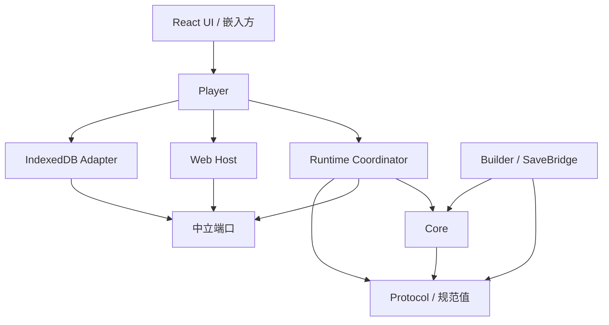

# galbox-sdk 实施架构

状态：M0–M5 按此架构建设；具体通过状态见 tasks.json 与 evidence/。本文把 [v0.6](reference/GalBox-SDK-v0.6-Implementation-Design.md) 收束为可开发的模块。长期语义约束见 [CONTRACTS](CONTRACTS.md)，阶段范围见 [MILESTONES](MILESTONES.md)。

## 1. 技术选择

| 部分 | 决定 | 实施约束 |
| --- | --- | --- |
| 语义 Core | TypeScript strict、纯同步调用、无宿主 I/O | 只做标准状态转换，不直接读取设备时间 |
| 协调与 Web Host | TypeScript | 同一生产运行时，Node 虚拟 Host 验证同一 Core |
| 图像 | 单 PixiJS 场景图，WebGL2 优先/Canvas 兼容后备 | 初始 x/y/alpha/层级；原型也使用这一后端 |
| 正文 | 独立 DOM/CSS 控制器 | 逻辑画幅、文本版本、揭示进度由标准状态控制 |
| 默认菜单 | React | 只订阅 Player 只读视图、提交语义动作 |
| 音频 | Web Audio；按后续素材需求增加媒体元素路径 | M2 先真实短 WAV，明确重播/停止恢复；不宣称精确长音轨续接 |
| 协议 | JSON Schema → TS 类型与 Ajv validator | 约束支持的 Schema 子集；规范化和语义链接单独执行 |
| 存储 | IndexedDB | 命名空间、修订、profile 批次与 activation 回执 |
| 构建 | pnpm workspace、TypeScript、Vite | M0 固定相容版本、packageManager/engines 与 lockfile |
| 验证 | Vitest、规范 trace、Playwright、打包消费者 | 真机和原作对照在对应发布门槛单列 |

不预建 Rust/WASM Core、另一套舞台状态解释器、剧情 Worker、OPFS、通用插件市场。若出现真实阻塞，先用有界样本证明，再在既定边界内评估变更。版本在实际 Codex 环境的 M0 核对锁定，不能把文档历史验证版本当作“当前最新”。

## 2. 仓库与公开入口

这些路径由 Codex 在实现时创建；本任务包不放空包冒充实现。

| 路径 | 内容 | 创建阶段 |
| --- | --- | --- |
| packages/galbox-sdk | 主库及有明确依赖边界的内部模块 | M0 |
| fixtures/standard-novel | 《灯塔来信》Builder 输入、生成数据、原创素材和期望状态 | M1–M2 |
| apps/playground | 可玩 Player、诊断面板，只消费公开 API | M2 |
| tests/consumer | 安装打包产物的隔离消费项目/测试夹具 | M2 |
| fixtures/synthetic-saves | fixture-save@1 自制格式和损坏/版本样本 | M3 |
| packages/cli | 真正的 CLI 编排；本地包名可暂用 @galbox/cli | M4 |
| ports/narcissu、ports/fata-morgana | 版本、映射、义务和私有参照入口 | N/F，资料可用即推进 |
| docs | 当前规范、操作表、能力、决策、任务与验收证据 | 全阶段 |

SDK 主包目标名 `galbox-sdk`，公开 npm 名称尚未核验。内部模块为 protocol、core、runtime、program-tools、save-bridge、web-host、storage、player、react、testing；模块不等于独立发布包。

| 子路径 | 导出的能力 | 真正提供的阶段 |
| --- | --- | --- |
| galbox-sdk/protocol | wire 类型、验证结果、版本与诊断 | M0 |
| galbox-sdk/core | Core 工厂、事件步进、保存与恢复校验 | M1 |
| galbox-sdk/port-kit | Builder、链接、资源引用，后续扩展/兼容登记工厂 | M1；M3 加入相应能力 |
| galbox-sdk/player | createPlayer、语义动作、保存/加载、生命周期与订阅 | M2 |
| galbox-sdk/react | 默认 UI 组件及 Player 绑定 | M2 |
| galbox-sdk/testing | 虚拟时间/Host、trace 与行为断言工具 | M1 |
| galbox-sdk/save-bridge | 已登记来源、codec、mapping 与不透明导入计划 | M3 |
| galbox-sdk/diagnostics | Program/快照追踪、SourceMap 与行为覆盖诊断 | M4 |
| galbox-sdk/backups | 有界持久备份、完整内容迁移与隔离恢复计划 | M5-01 |
| galbox-sdk/release | Program/目录/注册表/资源事实与预算的发布闭包 | M5-02 |

根入口只导出常用 Player API；headless 用户使用 core/protocol 子路径。exports 精确列出，禁止 `./* → ./src/*` 暴露私有实现。某子入口尚未实现时不导出抛 NotImplemented 的伪产品接口。React 等可选 UI 依赖不能被 core 的运行包或类型声明间接引入。

## 3. 依赖关系

箭头表示代码依赖；设备实现通过端口与协调器连接。

- protocol 不依赖 Core 或任何环境实现。
- Core 只依赖 protocol、确定性状态/数值算法和冻结操作注册表。
- runtime 定义效果、资源准备、时钟、存储端口并依赖 Core；不导入 Blob、File、DOM AbortSignal、IndexedDB 或 Node 文件 API。
- Web adapter 把中立请求取消转换为 AbortController 等实际操作。中立端口可以使用普通数据、Uint8Array 和 Promise，但不让 Promise 成为 Core 保存的 continuation。
- program-tools 处理数据构建与链接；文件访问由 CLI/Node adapter 执行。
- SaveBridge 使用公共校验接口构造候选，不访问 Core 私有对象，不成为 Core 的反向依赖。
- Storage adapter 不执行剧情或加载钩子；Player 负责组装，React 不成为第二个解释器。

`protocol/core/runtime` 使用不包含 DOM/Node types 的单独编译配置。另加明确导入边界检查，防止类型无误却通过动态 import、聚合入口或间接依赖把 Web/Node I/O 引入 Core。端口和测试可以异步；Core reducer/dispatch 的语义本身保持同步。

## 4. 权威状态归属

通用能力完整目标与实例边界见 [COMMON_VN](COMMON_VN.md)。SDK 不等同于 headless Core：设置/存档管理/流程图/鉴赏与默认屏幕属于可复用 SDK systems/UI，设备效果属于 Host，可恢复剧情/窗口/交互状态属于 Core。作品实例提供版本化定义、素材和主题，不能让 React 直接改 PC 或要求实例重写通用系统。

| 组件 | 持有和决定 | 不持有 |
| --- | --- | --- |
| Core | PC/调用帧、值、工作 profile、逻辑舞台/文本/音频意图、任务组/等待、保存资格、扩展状态 | DOM、纹理、媒体节点、数据库句柄、真实系统时间 |
| Coordinator | 事件队列和受理时间、预算 continuation、Host 结果路由、进度批次、准备/激活请求资格 | 作品专属变量解释、真实画面对象 |
| Web Host | 资源获取/解码/绘制/声音、设备失败、物理输入转换、租约 | PC、剧情变量、独立保存许可 |
| Storage | 原子写入、expectedRevision、不可变回执、命名空间和 activation head | 自动合并后重新解释剧情 |
| Player | 生命周期与上述组件组装、易用公开 API、只读订阅 | 独立于 Core 的另一份可修改剧情权威 |

## 5. 六条关键执行路径

### 5.1 启动

Builder 或其他工具产生 wire Program/Bundle/资源目录。接入边界按 unknown 读取，依次做结构、值规范化、引用/帧/能力链接，形成绑定 release 的 LinkedProgram/ResolvedRelease。建立工作 profile、Core 与 Host，用户开始动作进入同一协调器。

### 5.2 正常推进

输入绑定 inputId、promptId 和上下文；coordinator 在接收时固定序号与活动时间。Core 执行到合法语义等待，返回已提交 transition 的 effects、viewChanges、progressChanges。Host 报告结果并重新入队，订阅者也不能直接重入 Core。

固定操作预算只影响让出线程；resume 继续同一逻辑轮次。逻辑确定性比较同一规范事件序列，不能把不同机器的物理事件时间当成天然相同。

### 5.3 保存

所有入口经 Core 检查，在一致 captureSeq/time 捕获 SnapshotHandle。槽位写入可异步完成；之后进入禁存区不撤销已经合法捕获的数据，也不能借旧许可再捕获新状态。恢复闭包包括帧、文本、等待、活动任务、可达结果和 profile 依据。设备句柄不入档。

### 5.4 普通进度

profile action 与 RunState 在同一 transition 更新工作视图。coordinator 汇集 progressCommitId/基修订/工作序号范围/摘要固定的批次，Storage 同事务写 profile 与回执。成功只清已提交前缀；同 ID 重试不能更换 payload。旧快照不回写旧 profile。

### 5.5 加载与接管

校验、迁移和资源准备发生在候选上；尚未提交的准备失败不破坏旧会话。最终激活前冻结旧 Core，处理 dirty 进度并重验候选依据。原子提交 activation head/回执/必要 profile 更新后，旧 Core 失去写入资格；新 Host 接管并建立新 runEpoch。被新激活取代的旧 pending 不再接管，迟到成功回执也要校验 head。

### 5.6 原版导入（M3 起）

文件由环境 adapter 转为带角色/摘要的标准包。codec 解释已知格式，mapping 绑定发行版与加载语义，prepare 生成不可随意修改的计划。必要 recipe 在候选 Core 中有界执行，真人交互留待激活后。commitImport 创建槽位/独立 profile 分支，load 再单独激活。导入成功与接管成功分别报告。

### 5.7 便携备份（M5-01）

单次只读事务读取全部持久 profile 与当前/上一槽位闭包。备份不携带 activation/owner/回执。准备验证全部引用、生产 Core 和有界 recipe；跨 release 须显式完整迁移。原子恢复仅添加新的 profile/槽位并保存幂等回执，保留原数据和当前 head。有槽位时 load；只有普通进度时明确 start(profileId) 从头开始。默认 UI 在刷新后仍能列出独立进度。详见 [BACKUPS](BACKUPS.md)。

## 6. 初始能力与扩展点

M0–M2 使用有限值与操作，不直接执行原脚本或任意 JS 表达式。表现坐标/时间可以是经范围校验的有限数值 DTO；这不等于已实现原语言所有 f64 运算。

M3 接入同步逻辑扩展：类型化 initialize/reduce、按 invocation 保存状态、所有权隔离、有限 actions/effects 和可序列化等待。纯表现扩展接收标准效果并遵守取消/恢复。构建期组合优先展开成标准操作。

不能恢复的能力先明确禁存或返回 unsupported；不能把“当前先简单实现”写成静默丢失状态。新功能只在需要时加入实际 Schema、操作表、能力表和验收，不预先把所有未来 opcode 当有效输入。

## 7. 工程产物

M0 实现构建期生成和只读漂移检查，明确哪些生成文件进入版本库。若提交生成物，CI 在临时目录再生成并比较；若不提交，则干净构建生成且消费者只能使用该结果。不能让 check:generated 自动修文件后无条件成功。

主库输出 ESM、类型声明和必要静态/协议产物；Node 测试从 headless exports 使用同一实现。M2 对 tarball 做独立安装测试，检查 exports、类型和依赖完整性，不借源码 paths。M4 CLI 可调用成熟构建/素材工具，不重做编解码器。

开发 trace 与玩家历史分开；公共 fixture 原创可分发，真实素材和私有原档不默认提交仓库。阶段报告说明已验证环境和缺口，性能数值以测量为准。

用户设备实际反馈后的图像调整见 ADR0021/GRAPHICS.md：Canvas 是同一 Pixi 场景图的设备实现，不改变 Core/Coordinator/存档；滤镜/隔离转场按 ADR0022 以本实例 Canvas 离屏栈实现，预算/故障前置拒绝，不改 Core 状态格式。

G3-03采用ADR0023：影片为同Pixi图像舞台上的独立平面，Host的私有HTMLVideoElement/VideoSource负责设备，Core保存待播/播放/结束/跳过及恢复意图；interaction.prompt由Core保存已解析选项/期限和prepared/active阶段，UI仅报告readiness。影片/互动的普通保存与初始激活资格分开，不将注册能力等同任意编码或设备可用。
