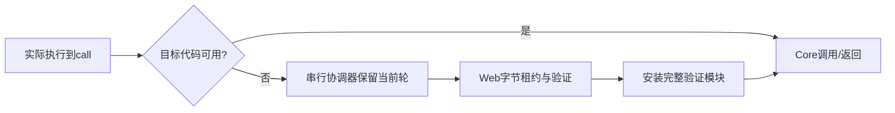

# 程序模块与执行依赖加载

W1-03B/ADR0035提供函数级代码模块。它使用同一Core/Coordinator/Player，不由React切换剧情解释器。编译生产者读取完整Program并检查链接；浏览器只下载入口模块和随后实际调用需要的模块。

```ts
import {compileProgramModules, createModuleProgram} from 'galbox-sdk/port-kit';
import {createModulePlayer, createHttpModuleProvider, createHttpProvider} from 'galbox-sdk/player';

// 构建阶段：resources是实际检查得到的资源事实。
const files = await compileProgramModules({program, series: '1', resources}, [
  {id: 'entry', uri: 'code/entry.pb', functions: ['main']},
  {id: 'shore', uri: 'code/shore.pb', functions: ['shore']},
]);
// 将manifest用encodeWire发布为.pb；代码文件使用files.files[i].bytes的protobuf内容。

// 浏览器：manifest来自外部protobuf解码，工厂验证后生成有运行时身份的对象。
const source = createModuleProgram(manifest);
const player = await createModulePlayer({
  program: source,
  moduleProvider: createHttpModuleProvider(source, baseURL),
  provider: createHttpProvider(source, baseURL),
  mount, saveCompatibilitySeries: '1', loading: {mode: 'demand'},
});
```

清单包含静态header、函数参数/局部布局/返回类型、全局唯一锚点、模块URI/长度/SHA和release事实。它不包含未加载函数体。每次代码获取检查lease身份、独立字节、protobuf、长度/SHA、Schema、函数接口/锚点和真实链接。partial linker使用声明检查跨函数call，不伪造函数体。未知模块、接口或摘要不符均失败。

Core执行到尚未加载的call之前，PC和调用参数保持原位，返回预算yield并报告所需函数；Coordinator通过中立准备端口等待代码，再继续同一轮。输入不重新提交，旧提示的迟到输入不能重复选择。等待/失败中保留旧呈现并禁止捕获和flush，默认UI可用retryResources重试；dispose取消本实例请求，迟到lease仍归还。



快照的programModules绑定完整清单摘要以及本Core使用过的模块集合。恢复先准备该集合，再检查调用帧、返回点、任务与等待关系。其他候选或其他Core把代码放入共享source缓存，不会自动扩大当前Core的执行集合。清单改变或缺少原绑定会拒绝旧档，不自动猜迁移。旧单体快照与模块快照之间没有隐式转换。

release.origin为modules：已获取的模块按独立摘要验证；尚未全部下载时不宣称重新计算了完整Program摘要。最后一个模块安装时再核对完整重组Program与生产者摘要。模块代码protobuf与SDK自身JS包是两个层次，后者仍主要由Vite打包。

当前支持基础ADV/control/choice、i32/bool/string、基础stage/audio.wav/tasks/profile和静态presentation。高级媒体/富文/窗口/剧本UI/流程图/鉴赏/扩展/RNG、模块recipe/SaveBridge/备份恢复和历史回溯暂明确unsupported，B2继续补齐。默认模块历史回溯关闭；普通保存/读取、历史文本和备份导出保留。单体Program原功能继续可用。

资源仍独立使用eager/demand/balanced/chapter策略；代码当前仅实际调用触发，无自动代码预取。模块内所有函数一并下载，单个大函数内部的未选分支也在同一函数体里，作者分组决定粒度。已使用代码暂不淘汰，原输入/内存上限保持，不能据此声称任意规模大作完成。

原创“分途的回声”验证root→sea→logic，未选interior不请求；原《灯塔来信》也经同一compiler分成真实函数模块，验证图片/WAV/并行任务保存恢复。试玩`?demo=modules&renderer=canvas`。实际验收以tasks和evidence/w1-03b为准；强类型/传输/i18n事实见TYPE_AND_DATA_AUDIT。
