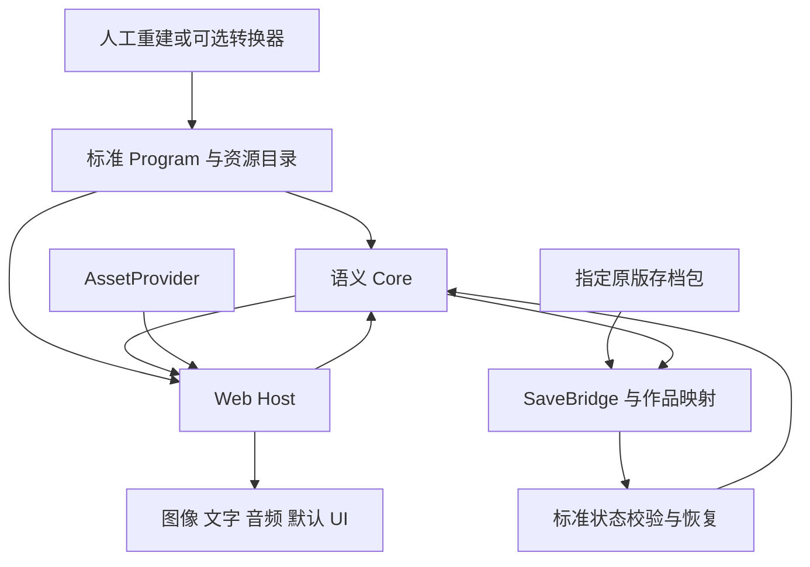
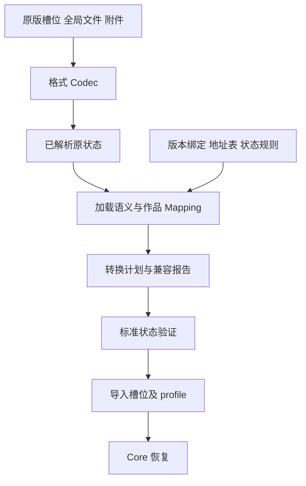

# GalBox SDK 强类型运行契约、能力边界与实施设计

文档版本：0.6  
日期：2026 年 10 月 24 日  
状态：完成 v0.5 二次规格审查并修订跨模块契约；已做针对性编译验证，SDK 运行时与两部目标作品尚未实现或验收

## 阅读结论

**GalBox 定位为面向视觉小说移植开发者的 Web 运行与兼容 SDK：接收标准游戏程序、可使用的素材和作品配置，提供可嵌入播放、明确的执行语义、完整状态恢复、原版存档适配接口和兼容性验证工具。**

**强类型是公开 SDK 和内部模型的硬约束。** 本版将它具体落实为指令/参数、变量/值、资源/用途、等待/恢复事件、codec/mapping 的类型关联，以及外部 unknown 输入的结构验证、语义链接、数值规范化和运行时所有权隔离。仅启用 TypeScript strict 或写出一个 interface 不能视为已经完成这些要求。

v0.6 二次审查没有发现需要重开语言选择或扩大到通用旧引擎模拟器的理由。v0.5 的强类型、调用 ABI、并行演出、保存切点与移植证据方向继续有效；新的问题主要出现在这些契约之间：普通进度如何持久化、任务结果如何进入恢复闭包、加载回执如何失去接管资格，以及准备阶段到底可以执行哪些恢复操作。审查也实际复现了 DeepReadonly 丢失元组结构的问题，并发现 codec/mapping 类型样例尚未约束正式登记工厂。修订和证据边界集中在 16.5、17.4；不以增加功能数量代替关闭这些接口缺口。

Core 不负责识别某个商业游戏，不负责打开所有旧引擎归档，也不负责解决未知保护方案。原始资源准备和旧脚本转换属于可选上游。原版存档兼容是 SDK 的正式产品能力，由独立 SaveBridge 和版本明确的作品适配器完成；Core 只认识自己的标准程序与状态。

**技术栈确定为 TypeScript Headless Core + TypeScript Web Host；图像舞台首选单一 PixiJS/WebGL 后端，DOM/CSS 负责正文，React 提供默认菜单与开发面板。Rust/WASM 只作为有具体收益的可选模块。** 用户已明确 WASM 不是硬性条件；本方案不要求未来把 TS Core 重写为 Rust，也不维护两个生产解释器。图像舞台是独立的工程选择，Pixi 的选择依据和可反转条件见 3.5。

**实施主线是独立维护一个完整、范围收束的 VN 引擎与 SDK。** 自己掌握执行语义、演出生命周期、保存恢复和作品扩展；复用成熟的图像、音频、构建与测试设施。与 WebGAL 存在大量功能交集，原版存档格式不同本身不能证明自研的必要性；本轮选择自研的依据，是用户明确需要长期控制这些核心契约。WebGAL 保留为参考与复用对象，不再设置“必须先证明 WebGAL 不能满足”这一实施前置条件。

Tsukiweb 的实际源码证实了 TS 剧情执行器、DOM/CSS 主舞台、浏览器音频和网页存档可以组成完整的单作品播放器。其公开保存入口主要处理自身 JSON 存档，不能当作原版存档互通的现成实现。GalBox 借鉴其浏览器原生路线和作品/共用层拆分，额外承担稳定接口、原版兼容、扩展恢复和对照验证。[S25–S33]

本轮用户明确要求原版存档兼容，因此：两部目标作品在确定的发行版和保存范围内，**原版 → GalBox 导入由此前的“默认可选”提升为发布验收要求**。反向导出接口从第一版设计，但每个发行版、每种保存位置单独认证；“能导入”不默认包含任意时刻双向互通。

本文件替代 v0.5，保留此前已成立的状态、存档与扩展契约。文中的包、CLI、接口、性能预算和兼容等级均是拟定契约，不是已发布能力或实测结果。第 17 章分别记录 v0.5 的 13 项类型抽样与 v0.6 的针对性审查编译；它们不代表生产 API 或运行时已经实现。两部作品的实际程序、资源和原版存档尚未提供，不能声称已实现兼容。WebGAL 与 Tsukiweb 对比来自官方文档和固定提交的只读源码审查，提交号见第 18 章；没有把静态审查写成真实游戏运行验收。技术事实在正文以来源编号标注，其余为工程建议。

## 目录

1. 产品目标与能力边界
2. 与 WebGAL 的交集、区别和自研取向
3. 技术栈重新选择
4. 标准接入契约
5. Program、Builder 与稳定地址
6. Core、调度与异步生命周期
7. 可恢复状态与保存边界
8. SaveBridge：原版存档兼容
9. 扩展机制与作品差异
10. 图像、文字、音频与资源
11. 持久化、发布和内容更新
12. 公开 SDK、CLI 与开发流程
13. 两部作品的验收与验证体系
14. 工程组织与实施顺序
15. 决策记录与尚需确认的输入
16. 边界回归、硬问题与实施门槛
17. 强类型契约抽样验证
18. 参考资料

## 1 产品目标与能力边界

### 1.1 对外承诺

GalBox 接收符合标准的程序、素材和配置，在已声明的浏览器能力范围内运行；提供稳定的保存恢复接口和作品差异表达能力；让适配器能够将指定原版存档映射到标准状态，并通过原作对照验证其行为。

这里的“已知资源”需要拆开：

- **素材已可用**：图片、音频、字体等可以由资源提供器读取。
- **行为已表达**：对白、分支、变量、演出和菜单规则已写成标准 Program。
- **兼容依据已提供**：需要原版存档互通时，还要有准确版本、格式解释、状态映射和参照。

一堆图片与音乐并不能自动确定剧情和交互。统一入口统一的是这三类输入的接入方式，不承诺从素材猜出完整游戏。

### 1.2 分层责任

| 层 | 必须负责 | 不承担的承诺 |
| --- | --- | --- |
| Core | 标准指令、控制流、值语义、等待、逻辑状态、保存边界、标准恢复 | 原游戏识别、原始归档、特定旧引擎解释、原版格式解码 |
| SDK 与 Web Host | 资源接入、渲染、文字、音频、输入、存储、默认播放器、构建与诊断 | 自动得到缺失的剧情、字体、插件行为或保护参数 |
| SaveBridge 框架 | 存档包接入、codec/mapping 注册、转换报告、版本校验、导入导出编排 | 通用破解、未知格式自动识别成功、所有版本双向兼容 |
| 原版存档适配器 | 已知格式读写、加载语义、原状态与标准状态映射、版本范围、样本测试 | 只凭引擎名保证所有作品和补丁可用 |
| 具体移植工程 | Program、素材映射、表现配置、兼容规则、原作参照、发行范围 | 要求 Core 内置作品 ID 特判 |
| 可选上游工具 | 开包、原脚本解析、转换、编码处理等已知输入处理 | 作为使用 SDK 的必经步骤 |

存档可能也有专有封装或未知保护。适配器只有在获得可解析格式或已准备的中间数据时才能工作；把“所有资源都能处理”的旧承诺换成“所有存档都能读”同样不成立。

### 1.3 首版范围

**首版必需：** 标准程序入口、稳定地址、资源 provider、无 DOM 的 Core、默认 Web Player、完整内部存档、SaveBridge、原档导入诊断、两个目标版本的导入验收、逻辑回放、静态发布。

**按已证明的需求加入：** 原版导出、具有特定来源语义的操作、少量动态对象能力、复杂文本层、专有已知格式 codec、Rust/WASM 计算模块。

**不列为首版目标：** 通用旧引擎解释器、通用解密器、通用原生插件兼容层、可视化剧情创作 IDE、每一种浏览器存储后端、自动支持任意商业作品。

Core 的能力矩阵按功能列出，例如 `control.call@1`、`save.safe-anchor@1`、`history.project@1`。作品兼容表按“具体版本 + 方向 + 保存范围 + 证据”单独发布。

## 2 与 WebGAL 的交集、区别和自研取向

### 2.1 已核验的 WebGAL 能力

WebGAL 的官方变量文档已经区分普通变量、跨存档的全局变量、随场景调用保存的局部变量；其技术文档说明场景调用、分支、预加载、演出阻塞和历史回溯。[S01][S02]

进一步读取固定提交的源码后，可以确认：

- `ISaveData` 包含舞台状态、Backlog、场景数据和预览；场景数据包含数字语句位置、场景栈、场景 URL 和当前局部变量。[S04][S05]
- 保存读取权威演算态；命令先同步推进 `calculationStageState`，统一提交形成 `viewStageState`，再由 `IPerform` 启动运行时表现。这已经是逻辑与表现分离的设计。[S05][S08]
- 恢复会重新取场景、恢复位置和栈、停止旧演出，再重建表现。恢复器对对白和部分相对动画有专门策略，避免重复追加文字或重复叠加变换。[S06][S07]
- 内部有命令注册和处理函数机制；官方允许定制完整引擎后用于 Terre 项目。[S03][S09]

因此，不能把“有变量和存档”“有可恢复舞台”“支持自定义效果”列成 GalBox 独有优势，也不能说 WebGAL 做不了移植。

### 2.2 仍可能成立的边界

| 议题 | WebGAL 当前可核验基线 | GalBox 应当承诺的产品契约 |
| --- | --- | --- |
| 接入 | WebGAL 场景脚本、资源及定制引擎 | 无来源引擎依赖的 Program、AssetProvider、配置 |
| 保存位置 | 场景 URL、语句索引、场景栈 | 稳定地址、明确的执行阶段、检查点与迁移 |
| 原版存档 | 可额外编写映射与定制；不能从现有格式自动推出原版兼容 | codec 与语义 mapping 分离，版本与损失报告，正反方向独立认证 |
| 扩展状态 | 命令/IPerform 可定制，遵守自身状态模型 | 每个扩展声明状态 schema、版本、等待、恢复与迁移契约 |
| 保存策略 | 现有保存/恢复流程的语义 | 最近原作安全点、当前稳定点、禁止保存等显式能力 |
| 验证 | 已有运行机制和开发设施 | 原版加载结果及后续行为的对照 fixture，兼容范围报告 |
| 原作差异 | 通过脚本与定制引擎表达 | 通过固定语义操作、作品策略和有状态扩展表达 |

右栏是我们计划承担的维护责任，不是已经实现的领先能力。左栏也不是能力上限：加入封套、外部地址表或少量恢复钩子，可能已经足以支持某些作品。

### 2.3 为什么“格式不同”不足以决定自研

任何新 Core 都要选择自己的内部快照格式。改用 GalBox 格式不会自动理解原作的变量和执行位置。

即使使用 WebGAL，也可以实现：

1. 解码原版存档；
2. 把原作位置映射为 WebGAL 的场景和语句位置；
3. 构造其可恢复的舞台、变量和调用状态；
4. 调用恢复逻辑。

若这些步骤足以保留目标行为，复用 WebGAL 很合理。SaveBridge 中的格式调查与映射工作，无论使用哪个运行时都要完成，不能全部计入“WebGAL 额外成本”。

### 2.4 本设计的实施取向

**正式主线：独立实现小型 TS Core、完整 Web Host 与 SaveBridge；复用成熟的图像、媒体、打包和测试工具。**

这个取向依据的是长期 SDK 需要直接维护标准状态与恢复契约，尤其第三方作品反复带来的保存边界、值语义、加载钩子、菜单/历史规则和扩展状态。它不是对 WebGAL 技术能力的否定。

用户已经表达了希望完整控制引擎行为的产品取向，因此不再要求第一阶段先开发 WebGAL 适配器、再判断是否允许自研。第一阶段直接验证 GalBox 自身的真实保存与演出切片，所有实现围绕一个生产运行时积累。

参考项目仍有价值：可以对照它们的体验、命令生命周期、恢复处理与资源策略，遇到成熟且契约合适的独立模块时再评估复用。引入任何依赖都要明确状态归属与维护边界；不能仅因语言相同就把别人的整个应用结构当作 GalBox 的公共 API。

自研的范围包括让作品完整可玩的执行、图像、正文、音频、输入、资源、历史、存档和工具闭环。GPU 驱动、浏览器文字排版器、音频解码器和通用构建工具不属于本项目重做范围。

## 3 技术栈重新选择

### 3.1 正式选择

| 部分 | 首选 | 说明 |
| --- | --- | --- |
| 语义 Core | TypeScript，strict 模式，无 DOM/Node I/O 依赖 | Node 回放与浏览器使用同一份实现 |
| Program Builder、校验、CLI | TypeScript / Node | 构建标准程序；旧引擎转换器独立接入 |
| Web Host、公开 SDK | TypeScript | 统一语言与调试工具链 |
| 图像舞台 | 首选 PixiJS，单一 WebGL 后端 | WebGL2 作为首批验证基线；以真实演出切片确认，不预建第二套 DOM renderer |
| 正文 | DOM/CSS，独立布局与揭示控制器 | 固定画幅与原作排版优先 |
| 默认菜单与开发面板 | React | 订阅只读状态，不承担解释执行或逐字调度 |
| 音频 | Web Audio + HTMLMediaElement | 按循环精度和内存要求选择 |
| 对外数据协议 | JSON Schema + 生成的 TS 类型 + 独立语义校验 | 内部对象结构不直接成为公共格式 |
| Schema 工具 | Ajv；json-schema-to-typescript | 构建时生成校验器/类型，约束 Schema 子集 [S19][S20] |
| 浏览器持久化 | IndexedDB | 槽位、全局 profile、设置和导入记录 |
| 资源缓存 | HTTP Cache / Cache Storage | 与存档数据分开 |
| 工程组织 | pnpm workspace + Vite | 不增加必要的服务端运行进程 |
| 验证 | Vitest、固定事件回放、Playwright、真实设备 | 逻辑测试和原作对照分别负责不同证据 |
| 可选重计算或已知二进制 codec | Rust/WASM 或成熟现成库 | 有具体复用或性能证据再引入 |

Pixi 官方提供多种 renderer，并推荐生产环境使用 WebGL 路线。[S14] 依赖在首个正式切片锁定具体版本与 lockfile，不使用浮动 latest；工具列表并不意味着每一项都要拆成独立发布包。

### 3.2 为什么改变 v0.2 的 Rust Core 推荐

用户明确说明 WASM 并非必需。旧设计把旧脚本解析、二进制归档处理和 native/WASM 共享作为主要理由。目标收束后，前两项移出必需主线，原生嵌入也不是已确认的交付要求；不再以它们推导出 Rust Core 的优先级。

无 DOM 的 TS Core 同样可在 Node 和浏览器复用。原版存档兼容由状态模型、值语义、映射和验收决定，并不会因为使用 Rust 自动成立。当前也没有证明 VN 指令解释是主要性能瓶颈，图片解码、GPU 上传、字体布局和媒体播放属于另一层。

选择 TS 可以减少跨语言 DTO、WASM 构建、第三方扩展和调试负担。对给其他移植者使用的 SDK，这些成本值得优先控制。

这不是语言能力比较的绝对结论。Rust 的显式类型和所有权也适合状态机；若未来需要无 JS 环境的原生嵌入、已有高价值 Rust 库可复用，或实测 Core 计算占主导，再以同一协议和 fixture 评估 Rust。

### 3.3 WASM 的保留方式

保留语言无关的 Program、Snapshot 和 Effect 协议即可；不为未来可能出现的后端预建整套双解释器体系。

适配器可以内部使用 WASM，例如复用某个已知存档格式库；Host 也可以调用适合离线处理或纯计算的 WASM 模块。对外仍使用标准数据和资源接口。首版不要求共享内存、线程或跨源隔离。

若产品后来明确要求“整个语义 Core 必须是 WASM”，应把这作为新增硬约束重开语言决策，不把“可用 WASM”偷换成“必须全用 WASM”。

进程内采用直接的类型化 TS 调用，不为尚不存在的 WASM 后端引入每步 JSON 编解码、通用 FFI 或双状态副本。Program、存档、外部事件和扩展输出在其边界校验；Core 内部仍使用普通 TS 对象与明确的状态机。没有实际需要时，不引入 Worker、共享内存、插件沙箱或任意运行时模块热插拔。

### 3.4 从 Tsukiweb 借鉴什么

参考对象是 `requinDr/tsukiweb-public` 的《月姬》浏览器移植及其锁定的 `tsukiweb-common` 子模块。主仓使用 React、TypeScript、Vite 与 SASS；共用层已经抽出执行、图像、音频、历史和保存设施。[S25][S26]

| 实际核验的实现 | 对 GalBox 的启发 | 不直接扩大为的承诺 |
| --- | --- | --- |
| 作品 ScriptPlayer 继承 common 的 ScriptPlayerBase，注册作品命令 | 共用运行设施与作品代码分离；用 TS 自行维护剧情执行器 | 通用 NScripter VM 或任意原生插件兼容 |
| 主舞台由 DOM 的 img/div 分层，CSS 动画与遮罩执行转场 | 浏览器原生路线足以构成完整播放器；DOM 并非只能显示静态图片 | 两部目标作品的全部效果已经能由这套 renderer 准确复现 |
| 浏览器音频同时使用串流媒体和缓冲音频 | 按长音轨、短音效及循环要求选择播放路径 | 所有设备的循环、seek 与原作时序自动一致 |
| 保存槽位含 scenes/pages 上下文，单档和全量备份为 JSON | 显式保存可恢复的逻辑上下文；提供方便的玩家备份入口 | 原版 NScripter 二进制存档导入/写回 |
| 资源和源脚本先经工具准备，再由网页按块加载 | 上游整理与运行时分开，标准输入可以独立演进 | Core 负责未知封装、保护、缺失资源或自动推断剧情 |

上述具体实现见作品/共用执行器、图像组件、CSS 转场、音频和保存源码。[S27–S35] 这里的 DOM 舞台不代表项目完全没有 Canvas：部分局部视觉功能使用 Canvas，但它不是所核验版本的主舞台绘制方式。

必须保留的区别：Tsukiweb 的单档入口执行文本读取与 JSON.parse，导出执行 JSON.stringify；全量备份组合网页 settings 与 saveStates。其 slots/settings 使用 localStorage，history 使用 sessionStorage。网页存档迁移中还有作品专属场景和页码转换。这些实现适合它的内容组织，不能替代 GalBox 的原版 codec、版本绑定、稳定地址、明确 continuation 和多记录事务。[S31][S32][S33][S36][S37]

其演出命令通过完成回调、计时器和 UI 完成事件继续执行。GalBox 可以借鉴这条播放链，但需把可保存的等待阶段及任务身份放进权威状态，把 DOM、Promise、回调和音频节点留在 Host。React 的挂载时机不能决定 Program 是否存在某条合法指令。

### 3.5 为什么仍首选 Pixi 图像舞台

**语言选择已经收束为 TS；图像舞台目前首选 Pixi，这是工程倾向，不是已由两作样本证明的必要条件。** Tsukiweb 的 CSS 遮罩、卷帘和交叉淡化源码说明，仅仅“存在遮罩或转场”并不足以排除 DOM。[S29][S30]

GalBox 计划公开一般对象、层级、变换、组合遮罩、混合与效果扩展，而不固定为背景加三个立绘槽。首选 Pixi，是为了把这些图像操作集中到一个可控制的绘制与合成体系中。正文与菜单依然采用 DOM；引擎控制权来自状态和生命周期接口，不来自是否亲自编写底层图形库。

首个代表演出切片必须核对真实素材、规则图、混合结果、快进/暂停/完成、保存后恢复。如果效果清单证明 DOM/CSS/Web Animations 足以准确覆盖，且统一时间、结算与恢复接口更简单，可以在广泛实现前整体改选单一 DOM 舞台。首版不同时维护两个完整 renderer，也不把“未来可替换”演变成庞大的渲染后端插件体系。

DOM 正文不会自动进入 Pixi 的 GPU 合成。每个效果必须声明作用于图像舞台、正文、界面还是指定组合；需要文字参加图像遮罩的片段使用明确的纹理文本路径或其他经验证实现。不能默认对整个 DOM 截图，再宣称得到了无损、通用的全屏后处理。

### 3.6 “薄而完整”的准确含义

薄指覆盖范围聚焦 VN 移植；完整指一个作品能完成播放、选择、演出、历史、保存、恢复和发布。Core 自己维护控制流、值、等待、逻辑舞台、文本状态与扩展状态；Web Host 实现设备侧效果；SaveBridge 接入已知原版保存语义；工具将开发者的准备内容检查并发布为游戏。

使用者可从默认播放器开始，也可替换 UI、接入自己的资源来源、增加作品指令与原版适配器。扩展仍必须声明序列化和恢复规则。新作品所需能力先用具体样本表达，再判断进入标准操作、策略配置或作品扩展，不提前构建通用游戏引擎、ECS 或万能脚本虚拟机。

### 3.7 强类型的五层约束

TypeScript 采用结构类型，并允许部分不健全的类型行为；类型断言在运行时不执行检查。[S38][S39] 因此本设计承诺的是下列工程约束，不把 TS 描述为具有所有权证明、纯度证明或完备运行时类型保证的语言。

| 层 | 必须成立的约束 | 责任边界 |
| --- | --- | --- |
| 编译期关联 | op 对应 args，变量名对应值，资源对应 kind，等待对应 resume payload | 防正常调用者误接；不防 any、强制断言或未类型化 JS 绕过 |
| 外部结构 | JSON、原档、工具输出、Host/扩展边界数据先按 unknown 接收 | schema 校验形状，不独自证明地址、版本和状态合法 |
| 语义链接与规范化 | 校验数值范围、引用、调用帧、资源种类、能力和恢复阶段 | 形成与具体 Program/注册表绑定的验证结果 |
| 状态与所有权 | 权威状态无可变外部别名，非法状态组合无法通过普通 API 提交 | 编译期 DeepReadonly 与运行时隔离分别负责不同保证 |
| 兼容与实证 | 源规则、映射和继续运行行为有参照 | 类型正确不能证明移植忠实，必须运行 fixture |

协议 schema 是 wire 数据的唯一来源；生成类型、验证器与 schema 摘要一起构建，生成物失配时 CI 失败。规范化内部值可以使用 bigint、品牌类型与内部索引，其转换器是受审查的边界代码，不让两套手写协议类型长期漂移。Ajv 的类型守卫有用，但其 JSONSchemaType 对联合分支的完整覆盖存在限制，不能以泛型标注代替生成一致性和负例测试。[S40]

输入校验默认不使用 coerceTypes、useDefaults 或 removeAdditional 静默改写数据；需要的迁移和规范化在单独阶段执行并产生诊断。Ajv 官方说明这些修改选项会改变数据，并可能受求值顺序影响。[S41]

运行时指令采用“按注册表键映射，再取联合”的结构，使每个 op 与其参数一起成为联合成员。不能写成两个独立联合字段：op 属于所有名字、args 属于所有参数，然后期待编译器自动关联。资源 ID、程序地址、调用入口、帧 ID、毫秒、逻辑像素、音频采样位置等应采用不同类型；品牌类型负责防误用，构造器与链接器仍负责检查实际值。[S42]

Core 公共边界不暴露 any。unknown 可以出现在尚未验证的入口；合法动态原作值使用有标签联合和显式操作表达。有限类型断言只出现在经审查的品牌构造、生成代码接合或第三方库适配点，不能用双重断言绕过失败的协议检查。

除 strict 外，基线启用 noUncheckedIndexedAccess、exactOptionalPropertyTypes、noImplicitOverride、noFallthroughCasesInSwitch 和 noPropertyAccessFromIndexSignature。前两项分别防止将缺失索引当成现有值，以及混淆字段缺失与显式 undefined。[S43][S44][S45] Core 单独使用不含 DOM 的编译目标；公开 API 的类型回归与运行时负例都属于发布门槛。

## 4 标准接入契约

### 4.1 四个入口

| 契约 | 输入内容 | 作用 |
| --- | --- | --- |
| GameBundle | 作品身份、程序清单、能力、资源目录、表现/保存配置 | 统一发现和版本协商 |
| Program | 已表达的逻辑、演出和交互 | Core 的唯一剧情输入 |
| AssetProvider | 逻辑 ID 到可用资源的解析与获取 | 隔离 URL、Blob、本地文件等来源 |
| CompatibilityBinding | 原版身份、存档适配器、地址/变量映射、支持范围 | 仅在声明原版兼容时必需 |

GameBundle 是逻辑上的发布单元，不限定为 ZIP。原引擎名、原始归档名和原脚本路径不是所有项目的必填字段；普通 SDK 项目可以完全没有它们。开启原版存档互通时，准确来源版本及映射依据才成为必需。

### 4.2 依赖关系



Core 不导入 SaveBridge、Pixi、React 或具体作品包。SaveBridge 依赖公共状态 schema 和验证 API；作品工程依赖 SDK 的公开 exports。逻辑模块先在仓库内清楚分隔，避免一次发布十几个没人单独使用的包。

### 4.3 GameBundle 草案

以下为自制 fixture 的示意，不对应任何目标游戏的真实文件：

```json
{
  "bundleSchemaVersion": 1,
  "gameId": "fixture-novel",
  "contentVersion": "1.0.0",
  "releaseId": "fixture-release-001",
  "program": {
    "formatVersion": 1,
    "semanticsVersion": 1,
    "entry": {"module": "main", "anchor": "opening"},
    "modules": {"main": {"uri": "program/main.json"}}
  },
  "assets": {"catalogUri": "assets/catalog.json"},
  "requiredCapabilities": [
    "control.call@1",
    "text.page@1",
    "save.safe-anchor@1"
  ],
  "presentation": {
    "logicalWidth": 1280,
    "logicalHeight": 720,
    "layoutProfile": "fixture-fixed"
  },
  "policies": {
    "save": "declared-safe-anchors",
    "clock": "pause-when-hidden"
  }
}
```

生产发布还应包含模块和资源摘要、长度、能力版本要求等信息。身份校验分为“这是哪一部作品”“这是哪一版程序”“这次部署是哪组资源”；不能只比较一个显示名称。

### 4.4 AssetProvider

接口需支持资源租约与流式使用，不强制将全部媒体转换成 ArrayBuffer：

```ts
// 接口草案；类型的完整定义在后续 protocol RFC 中生成。
interface AssetProvider {
  readonly catalog: BoundCatalogIdentity;
  describe<K extends AssetKind>(asset: LinkedAssetRef<K>): AssetDescriptor<K>;
  acquire<K extends AssetKind>(
    asset: LinkedAssetRef<K>,
    request: { priority: ResourcePriority; signal?: AbortSignal }
  ): Promise<AssetLease<K>>;
}

type AssetLease<K extends AssetKind> = {
  readonly kind: K;
  readonly identity: ResolvedAssetIdentity;
  readonly integrity: IntegrityEvidence;
  readonly source:
    | { readonly kind: "url"; readonly url: string }
    | { readonly kind: "blob"; readonly blob: Blob }
    | { readonly kind: "bytes"; readonly bytes: Uint8Array };
  release(): void;
};
```

Host 根据用途选择媒体元素、解码器或缓冲。租约规定对象 URL 的创建/撤销和缓存引用；某个消费者取消，不应破坏其他消费者仍在使用的资源。数据正确性检查不能要求长音轨先整体下载后才允许流式播放；完整离线校验与在线播放的保障级别分别描述。

提供 HTTP manifest provider 和显式选择文件的 provider 示例。它们只读取已经可用的资源；本地 provider 不等于自动解开原版安装包。

租约解决存活期，字节所有权另行约束。Host 接收外部 lease 后建立私有的稳定元数据；bytes 路径默认复制为 Host 独占缓冲，再按该实际缓冲验证摘要和解码。readonly 属性不使 Uint8Array 内容不可变，provider 给出的 verified 标记也不能替代这一步。使用不可变 Blob 或内部受控缓存句柄时可省去不必要复制；不能把共享可写缓冲当作不可变 release 的组成部分。首版不接受可并发改写的共享缓冲作为已验证素材。

取消 acquire 后若仍迟到返回成功，发起获取的 Host 适配层负责立即归还未接管的 lease；provider 在返回 lease 前的失败清理由 provider 负责。正常接管后的释放归所属资源管理器，release 幂等。两个消费者的取消、释放或输入缓冲修改，均不能改变另一消费者已取得的内容和有效期。

本地文件的选择权限和对象属于当前 Host 会话。刷新或在另一浏览器载入备份后，provider 可以通过结构化获取失败/诊断报告 needs-resource-selection，由 Host 呈现重新选择并按目录/摘要重绑的流程；它不是 acquire 成功结果中的另一种 lease。不能把旧 blob URL 或同名文件当成长期内容身份。该示例不要求持久文件系统权限或 OPFS。

LinkedAssetRef 由绑定到具体资源目录的链接器产生，同时携带资源种类、逻辑 ID 与目录身份。程序需要图片时不能传入音频引用；普通字符串必须先解析，失败会产生带地址的诊断。类型品牌不能证明两份运行时 releaseId 相等，provider 和 Host 仍要检查实际目录/发布身份。

ResolvedAssetIdentity 记录 releaseId、目录摘要、assetId、variantId 和预期内容摘要；IntegrityEvidence 区分已验证摘要、版本化流式地址、尚待验证等状态。配置了预期摘要不等于实际字节已经验证。解码就绪、下载完成和纹理可用也是不同阶段，不能用 acquire Promise 已返回代替全部就绪。

### 4.5 一次运行的发布闭包

Player 先构造 ResolvedRelease，将 Program 模块、资源目录、语义版本、扩展实现与 CompatibilityBinding 绑定成一组不可变输入。资源 provider 必须与这份目录匹配，不能再独立指向一个会在部署时变动的 catalog URL。长音轨流式播放无需先整体校验，但其版本化身份和校验等级必须明确。

发布闭包负责运行中不混用内容。存档的语义兼容负责旧状态能否用于新内容，二者分开：仅图片重新压缩可以在明确策略下接受旧档，不因此要求所有历史 release 的字节永远相同。实际部署需定义旧 release 保留范围，资源缺失产生明确恢复路径，不能承诺浏览器缓存永不驱逐。

已可用素材的可选构建流程输出 ResourceBuildRecord：输入摘要、工具/配方版本、参数、输出摘要、逻辑画布与裁切/缩放映射。原图坐标、逻辑舞台坐标和设备像素使用不同类型；缩放变体不能悄悄改变立绘锚点或规则图坐标。

### 4.6 能力声明与当前环境检查

Program 注册了某个操作，只说明有对应语义实现，不说明任意设备和任意素材都能执行它。首版以分层检查表落实能力协商，不建设通用插件谈判系统。

| 检查层 | 检查时机 | 结论用途 |
| --- | --- | --- |
| Program/扩展语义 | 构建与链接 | 操作版本、值、恢复和依赖是否可表达 |
| 发布素材配置 | assets build 与发行验证 | 编码、字体、尺寸、循环模式等是否属于目标配置 |
| 当前 Host 环境 | prepare、必要资源尝试与恢复准备 | 渲染/媒体/存储条件是否实际可用，是否待用户动作 |
| 已验证平台 | 真实设备与对应 fixture | 哪组设备/浏览器及内容范围已通过，不能从探测结果推导 |

环境结果至少区分 available、blocked-by-user-action、unavailable、not-yet-verified；unknown/未验证不能当成通过。运行中媒体拒绝仍按 6.8 处理，但发布验收不能用永久 blocked 掩盖必需能力没有实现。当前载入所需的条件在替换旧会话前检查；全作品能力由发行套件覆盖，不要求启动前预下载全作素材。

## 5 Program、Builder 与稳定地址

### 5.1 标准程序的产生

标准 Program 可由开发者手工构建、TS Builder 生成、已有工具转换或社区适配器输出。构建期的 JS/TS 用于生成数据；剧情运行不是执行这些构建脚本。

SDK 保留 Builder、链接器、资源引用校验、地址注册和诊断。这些是**标准程序工具**。旧 KAG、NScripter 或其他方言转换器是可选上游，不是同一个组件。

### 5.2 最小指令集

| 指令族 | 首版内容 | 必须固定的语义 |
| --- | --- | --- |
| 控制流 | jump、call、return、branch、end | PC、返回点、局部作用域、调用参数 |
| 值与变量 | 读写、明确类型算子、条件 | 数值范围、溢出、转换、比较、真假值 |
| 文本 | 页、分段、说话者、ruby、显现、清除 | 等待点、完成文字与下一步输入的区别 |
| 舞台 | 对象、图层、变换、遮罩、转场 | 对象身份、终态、并行任务与提交屏障 |
| 音频 | 通道、播放、停止、增益、循环 | 阻塞与否、恢复模式、完成事件 |
| 交互/时间 | action、choice、wait、timer | 请求身份、竞争顺序、暂停和保存规则 |
| 作品系统 | UI policy、历史投影、profile 更新、checkpoint | 权限、状态作用域、持久化时机 |
| 扩展操作 | 有名字、版本和 schema 的操作 | 显式状态、效果和 continuation |

不通过任意 JS eval 执行剧情表达式。不通过 gameId 改变一个加法或比较算子的含义。源差异用明确操作或构建期展开表达，例如整数回绕和溢出报错是不同操作。

### 5.3 值模型

Core 语言采用 TS，不等于源值全部退化成 JS Number。

协议可表达的 tagged values 包括未定义、null、bool、string、i32、i64、f64、有序列表和字典；首个语义版本只实现样本实际需要的操作。i64 内部使用 bigint，对外使用带类型的十进制字符串；f64 对外使用大端顺序的 16 位十六进制位模式文本。每种已启用值类型都必须具有下述明确规则，不能只保留类型名。

```json
{
  "counter": {"type": "i64", "decimal": "9223372036854775807"},
  "ratio": {"type": "f64", "bits": "3ff0000000000000"},
  "unset": {"type": "void"}
}
```

协议不直接序列化任意 JS 对象。JSON.stringify 对 BigInt、undefined、非有限数和循环引用的默认行为不能作为游戏语义。[S18]

若原作依赖共享引用或循环对象，必须增加显式 heap/ref 能力并验证；复制两份对象不能保持原来的别名关系。未出现这些需求前不实现完整动态对象 VM，遇到超范围状态则阻断或降低已声明的兼容等级。

WireValue 是可序列化数据；NormalizedValue 是经过范围、表示和所有权检查的内部合法值。所有 Builder、mapping、恢复和扩展输出都必须进入同一规范化边界，不能以手写 as NormalizedValue 构造权威状态。规范化取得独立的数据所有权，输入对象在随后被调用方修改时不能改变已验证结果。

| 类型或操作 | 基础语义契约 |
| --- | --- |
| i32 | 构造范围为 -2147483648 至 2147483647；越界拒绝，不隐式截断；回绕和检查溢出的加法使用不同操作 ID |
| i64 | 构造范围为有符号 64 位；wire 为规范十进制文本，禁止加号、前导零和 -0；进入后才转换 bigint |
| f64 | wire 保留正负零和无穷；基础能力将 NaN 规范为固定 quiet NaN，算子逐项规定 IEEE 行为；若原作观察 NaN payload，则基础能力不声明完整保留 |
| 字符串 | 保留内容，不默认 Unicode 归一化；按 UTF-16 单元、码点或字素计数是不同操作，不能混用 |
| 字典 | 明确以插入顺序保存键值，禁止重复键；contains 与 get 分开，区分键缺失、void 和 null |
| 列表/字典值 | 基础模型为值语义，更新通过受控操作；引用身份必须由单独声明的能力提供 |
| 数值转换、比较、真假值 | 有具体类型组合与错误规则；禁止沿用 JS 隐式转换作为默认源语义 |

字典的 wire 表示固定为有序 entries 数组，每项为键与 WireValue 的二元组；规范化时拒绝重复键。不能用普通 JSON 对象替代这份顺序契约。例如先插入字符串键 "10"、再插入 "2"，编码、解码和遍历仍维持这个顺序。原始格式如何处理重复属性由 codec 明确解析，不能先丢弃信息再宣称保留了原语义。

动态原作变量可以声明为有限 tagged-value 联合或受约束的动态槽。强类型约束的是允许的值及操作关系，不要求原作每个变量终身固定为单一 TS 类型。运行时分支检查仍是这类动态槽语义的一部分。

### 5.4 稳定地址

运行地址使用 `moduleId + anchorId`，快照还要包含执行阶段与等待描述。公开地址不能只依赖源行号、数组下标或台词 hash。

Builder 为节点维护持久注册表；人工代码可以声明稳定 ID。修改文字、插入前文和改变打包顺序不应无故改变旧节点身份。节点拆分、合并、删除或语义改变必须提供迁移或明确失效。

如有原作，另外建立 `OriginalLocator ↔ GalBoxAddress` 映射。原作定位可能是标签、字节偏移、命令序号或复合结构；它有准确发行版和脚本摘要约束。两类地址不是同一个概念。

映射匹配有歧义时要求维护者明确处理。相同台词出现两次，不能凭文字相等把原存档猜到其中一处。

### 5.5 Program 验证

Schema 负责数据形状；语义验证负责跳转目标、变量类型、资源引用、能力版本、恢复边界、扩展状态和映射覆盖。动态资源引用需声明候选集合或可验证的 resolver 约束。

未知 opcode、缺失必要能力或未处理的行为不能自动忽略。开发模式可以记录诊断并让维护者探查；正式构建需要明确阻断项已经解决或列入经批准的差异范围。

### 5.6 最小调用 ABI 与操作规范

call/return 需要可验证的调用约定。每个可调用入口登记 callableId、入口地址、参数 schema、结果 schema、局部槽位布局和 frameSchemaVersion；每个调用点登记参数绑定、返回值目的槽与 continuation。跳转目标必须位于当前允许作用域；跨入口转移必须使用已定义的调用或尾调用能力，不能靠任意 jump 破坏栈。

调用参数按已定义顺序求值，验证成功后再提交新栈帧；返回值先匹配调用点声明的结果类型，再写入返回槽并恢复 continuation。帧存储 callableId、帧布局版本、参数/局部值、返回位置及阶段，使用受控的显式栈而非宿主 JS 调用栈。最大帧深度和数据规模属于明确运行限额。

恢复校验必须同时检查当前 PC 所属入口、帧间调用关系、返回 continuation、局部值类型和等待 phase 与指令是否匹配。逐个地址都存在仍可能是一份非法栈。入口/帧布局变更必须迁移；不能只因 anchorId 未变化就放行旧帧。

所有首版公开操作必须配套 OperationSpec：ID/语义版本、输入/结果类型、前置条件、状态读写、控制流、失败、等待/并发、快进、取消、保存、恢复及原版导出影响。动态目标只能来自已登记且签名相容的集合或受验证 resolver。该规范只覆盖当前能力集合，不建设完整旧语言虚拟机。

### 5.7 移植行为覆盖清单

声明原版兼容的工程维护 PortObligation 清单，记录来源依据、行为说明、目标实现、处理方式、证据和工作状态。处理方式是标准操作、构建期展开、作品扩展、已接受差异或未解决；工作状态另行记录自动生成、人工重写、需要对照或缺少资料。

清单可以由人工、Builder 或上游工具建立，不要求 Core 识别原安装包。普通标准内容项目不需要伪造原作证据。未知源行为未登记时，SDK 不可能自动知道缺漏；因此报告同时保留清单覆盖的范围及未知范围，不能用“清单全绿”宣称整个原作已被形式证明。

Program 通过结构/语义检查，只证明提交的程序可以按标准语义运行。兼容发布还要证明已登记的必要源行为得到处理。未解决的剧情义务阻断无剧情损失的发布声明；明确接受的表现差异保留在 FidelityProfile 中，不通过静默忽略指令消除告警。

## 6 Core、调度与异步生命周期

### 6.1 Core 的工作

Core 维护私有逻辑状态，接收规范事件，执行到等待点，返回效果描述与状态变化。它不直接读取时间、网络、文件、DOM、Pixi 或音频设备。

```ts
// 接口草案，不是现有 npm API。
interface Core {
  dispatch(event: EngineEvent, budget: StepBudget): StepResult;
  resume(token: ContinuationToken, budget: StepBudget): StepResult;
  requestSave(request: SaveRequest): SaveDecision;
  validateRestore(input: unknown, context: RestoreValidationContext): RestoreValidation;
  readView(): DeepReadonly<LogicalView>;
}

type StepResult = {
  effects: readonly EffectDescriptor[];
  viewChanges: readonly ViewChange[];
  progressChanges: readonly ProgressDelta[];
  progress: CoreProgress;
  diagnostics: readonly Diagnostic[];
};
```

实现可以内部顺序修改受控状态，不要求每条指令复制整棵状态树。公开快照和查询对象不得暴露可变内部引用。状态变更与效果发出都有事件序号，便于追踪和重放。progressChanges 是带 transitionId/工作序号的纯数据增量，由 Player 按 11.2 提交；Core 本身不写存储。显式进度 flush 作为有身份的语义屏障，由协调器的持久结果解除，不能由普通点击代替成功。

恢复使用工厂建立候选 Core，例如 `createCore({ program: linkedProgram, initialState: restoreHandle, extensions })`；候选实例通过校验后才由 Player 替换活动实例。validateRestore 只返回绑定到验证上下文的结果，不直接改写当前游戏，也不把调用方可任意修改的对象保留为内部状态。恢复工厂复核句柄与实际 Program/语义/扩展注册表是否匹配；初始重建效果通过独立结果返回，由 Host 在激活阶段执行。

### 6.2 主线程与执行预算

首版在主线程使用固定操作数预算执行，遇到对白、选择、计时、资源提交屏障或显式效果等待时返回。长的无等待循环触发 yield，Host 再安排 continuation。

预算只决定何时让出线程，不能改变剧情结果。预算耗尽后使用专门的 resume token，不能再次发送上一条点击或选择；否则同一个用户动作可能执行两次。

除非 profiling 证明需要，不引入剧情 Worker。Node 回放使用同一 Core 和虚拟 Host；它只能证明标准程序的逻辑结果，不能代替真实浏览器的文字、音频与显卡验收。

### 6.3 异步任务身份

Host 的任务携带：

- `runEpoch`：读档、重开或替换运行实例后变化；
- `objectLifetime`：对象销毁重建后变化；
- `slotGeneration`：同一对象的纹理、变换或音轨任务被替换后分别变化；
- `effectId` 与单次完成事件身份。

每次回调都核对有效性。换表情替代纹理任务，不应错误取消仍合法的位移动画。过期显示意图丢弃，但可共享的下载结果仍可进入资源缓存。重复完成通知不得重复推进剧情。

### 6.4 舞台提交与时间

区分目标舞台、已提交舞台和活动演出。关键资源未准备好时保留一致的旧画面；进入新画面、字幕或声音的时机由明确的依赖关系决定。

Core 管理逻辑演出描述，Host 插值逐帧表现。快进可以按操作规则结算到终态，但不得跳过必要的变量修改、分支、不可跳过的等待或全局事件。

计时使用注入的单调活动时钟。作品策略声明页面隐藏、菜单打开、暂停和读档时的处理；媒体播放时钟与剧情计时不是同一时钟。

限时选择默认在 prompt activation 屏障后起算：必要内容已准备、目标舞台/文本已逻辑提交，输入目标绑定当前 promptId/世代且可接受动作，由协调器受理 prompt-activated 事件后用同一活动时间建立 deadline。资源 ready 只是前置条件。计时未激活和已激活的等待是不同可恢复阶段；菜单阻挡或其他暂停原因依同一时钟策略处理。此屏障不承诺物理像素已经进入人眼，也不以 React 渲染回调直接决定剧情。

选择和超时由一个调度器串行受理。默认规则是受理时 `t < deadline` 才接受选择，`t >= deadline` 按超时处理。定时器回调迟到不能让过期点击成功。记录规范化时间与事件序号，以便重放竞争边界。

存档记录剩余逻辑时间或明确的重启策略，不记录旧 setTimeout 句柄。恢复后为等待生成新的宿主请求身份；旧页面上的按钮事件不能满足新运行的等待。

### 6.5 确定性的范围

同一标准初态、同一操作版本与同一规范事件序列，应得到相同的逻辑状态和效果意图。随机算法和状态显式登记，不调用未记录的 Math.random；影响逻辑的遍历顺序和数值运算必须固定。

跨浏览器字体栅格化、视频解码、GPU 混合和设备音频不保证逐像素或逐采样相同，采用各自的容差与参照验收。

### 6.6 单剧情流与并行演出

首版采用一个剧情控制流与多个并行表现任务。表现任务不能任意在后台修改剧情变量；影响逻辑的结果统一作为事件交回协调器。通用多 PC 脚本线程不在首版承诺内。

启动操作返回明确的 TaskHandle。等待绑定固定任务或已封闭的 TaskGroup，不能含糊地等待“当前全部动画”。组成员在封闭后不可因新增特效自动扩大，也不能由同一属性上的新任务替换旧成员身份。

| 任务终态 | 含义 | 默认等待处理 |
| --- | --- | --- |
| completed | 正常完成 | 满足成功条件 |
| settled | 按该操作已声明的快进规则结算到终态 | 只有该等待允许结算时满足成功 |
| cancelled | 主动终止，没有执行成功语义 | 返回明确结果，不伪造 completed |
| superseded | 被新的属性写入替换 | 立即结算旧任务身份，不能等旧回调或新任务替它完成 |
| failed | 已确定无法继续该逻辑任务 | 解除未决状态并进入定义的失败路径 |

每个任务只产生一次终态。首版默认 join 为 all-success；取消、替代或最终失败会得到显式组失败，不能永久挂起。仅在操作规范明确允许时，使用接受某些非成功终态的等待策略。race/any 等扩展如被采用，也必须固定获胜与剩余任务处理规则。

操作声明 writes 集合与冲突策略。首版同一对象属性可选择 replace 或 reject；需要排队时以显式程序/任务组表示。replace 先在逻辑上结算旧任务为 superseded，再创建新任务世代。等待的是旧句柄，不是可变的“当前 transform 槽位”。跨场景音乐、场景演出、调用内临时任务分别声明 owner/scope；换场景只处理匹配范围的任务。

### 6.7 不可重入的逻辑执行轮次

所有改变逻辑的入口经过同一个串行协调器。Host、状态订阅者和公开 Player 方法只提交消息，不在 Core transition 尚未完成时直接重入 dispatch/resume。即使资源已经命中缓存，完成消息也必须先入队。

一次被接受的外部事件启动一个逻辑执行轮次，执行到语义等待、结束或显式故障。预算耗尽只是暂停该轮；resume 优先继续未完成的轮次。普通输入、保存和效果结果在约定的语义边界裁决，不能因预算为 1、8 或 100 而插入不同的可保存中间状态。需要在长流程中响应输入的程序应声明真实等待/让步操作，而非依赖实现预算偶然让出。

暂停、停止和销毁可以在指令边界停止继续调度，但内部预算 continuation 不因此成为公开稳定存档点。超长轮次有确定的操作总量上限，超限进入明确故障；不能靠不断排入微任务让一个无等待循环永久占用页面。

事件信封记录 eventId、实例/请求身份、来源、受理序号和规范化活动时间。协调器收到消息时，在当时有效的输入上下文中固定受理时间和序号，消息按该序号排队；到达语义边界后裁决时沿用此时间，另记裁决时间，不重新取时覆盖。输入绑定当时的 promptId，裁决时再次检查提示、请求身份和权限，随后到达的新提示不能消费旧输入。

计时竞争使用第 6.4 节的受理时间规则；截止后才被协调器接收的输入，不能因原始 DOM 时间较早而获准。原始 DOM 时间、受理时间、裁决时间和媒体采样时间分字段保存。确定性承诺针对同一规范事件记录，不承诺不同设备的未规范化物理输入到达时刻完全相同。

单个同步扩展函数无法被指令条数预算抢占。受信任扩展必须有界，较长处理拆成显式阶段或移到外围工具；固定预算和 TypeScript 类型均不构成任意插件的 4 ms 执行保证。

### 6.8 Host 结果、失败与重试

资源和效果分别报告 ready、started 与 completed，等待屏障必须声明所需阶段。任务还可以处于 blocked，表示等待用户恢复音频、资源重试或其他允许条件；blocked 不是成功，也不是已经结算的失败终态。

每次 Host 尝试拥有 attemptId。可恢复错误使逻辑任务进入 blocked，并带稳定错误码及允许的恢复动作；重试增加 attemptId，仍对应原逻辑 effectId，不重新执行已经提交的变量更新或控制流。旧尝试结果失效。放弃或不可恢复错误才结算为 failed/cancelled；降级与忽略必须是显式作品策略，并记录到报告。

资源准备可以在逻辑提交前失败，已启动音频或画面则不能声称跨设备自动回滚。逻辑提交、资源就绪、呈现启动和人眼/扬声器实际输出是不同阶段；同步演出按声明的时序容差验收。

首版可恢复剧情 Effect 限定为受控的表现与资源动作。文件选择、下载、开新窗口及外部写入等需要当前用户动作的行为属于 Player/工具接口，不自动纳入读档重放，也不承诺跨外部系统 exactly-once。

### 6.9 输入的唯一消费与暂停原因

Host 把物理输入转换为带 inputId、promptId 和输入上下文的语义动作；同一次动作最多由一个上下文消费。模态菜单、选择与正文具有明确路由优先级。关闭菜单、显完文字、推进正文和提交选择是不同动作，不能由一次冒泡事件连续完成。

指针按下时绑定目标提示；释放时复核提示、对象生命周期和权限。按下 A 后超时切换为 B，释放不能提交 B。键盘 repeat 是否产生新的推进动作由输入策略决定，默认不把重复事件变成无限次 advance。

失焦、隐藏和进入模态层时清理按住快进等瞬态状态。暂停由原因集合控制，并按时钟域应用；关闭菜单只能移除 menu 原因，不能顺便解除 hidden 或 manual 原因。自定义 UI 必须使用相同的语义输入与权限接口。

## 7 可恢复状态与保存边界

### 7.1 状态分区

| 分区 | 内容 | 恢复规则 |
| --- | --- | --- |
| RunState | 下一指令、栈帧、局部/会话变量、RNG、等待、逻辑舞台、音频意图、文本页、UI policy、当次历史 | 从选定存档恢复 |
| PersistentProfile | 已读、结局、解锁、周目及跨槽位变量 | 按作品的逐字段规则保留、合并、替换或重置 |
| UserSettings | 音量、字速、辅助功能等设备/偏好 | 默认使用当前偏好；影响剧情的模式不能放在这里 |
| ExtensionState | 命名空间状态、schema 版本、挂起阶段 | 作为所属 run/profile 的一部分恢复和迁移 |
| CompatibilityState | 原版导出所需、无法从标准状态推导的有限信息 | 有版本、有更新规则；映射失效时禁止假装可导出 |
| HostEphemera | Promise、DOM、纹理、音频节点、计时器、设备状态 | 不保存，按逻辑状态重建 |

ExtensionState 与 CompatibilityState 是逻辑分区，存储时必须注明归属 run 还是 profile，不能形成另一套未纳入事务和恢复的隐藏状态。

### 7.2 保存位置决定正确性

定义以下通用策略：

| 策略 | 行为 |
| --- | --- |
| 当前稳定点 | 当前逻辑状态和可重建表现形成一致快照 |
| 最近安全锚点 | 保存最近明确捕获的完整安全点状态 |
| 可恢复等待 | 保存等待描述与已完成阶段，恢复剩余逻辑工作 |
| 当前禁止 | 返回原因，不暗中推进剧情制造保存点 |

KAG 官方教程说明保存可能回到最近的可保存标签；其存档数据说明还指出缩略图可能对应点击保存时的画面，而实际恢复位置更早。[S10][S11] 因此“恢复到按下保存按钮那一帧”并不必然等于忠实兼容原作。

保存策略由 Core 按当前 Program 和作品能力裁决。菜单按钮、快捷键及公开保存 API 必须经过同一入口。调用者不能传入一个任意策略绕过剧情限制。

### 7.3 快照不变量

PC 统一表示下一条待执行指令；正在等待时另存等待种类、逻辑阶段和已消费事件。避免把“执行后等待点击”恢复成“再次执行本句赋值”。

最近安全锚点必须持有当时完整一致的状态。不能用安全点的背景、当前的变量和任意猜测的返回地址拼成一份存档。画面已提交也不代表调用栈、等待和扩展状态已经安全。

快照至少记录：

- 作品、内容、协议、语义、快照 schema 与扩展版本；
- 稳定地址、调用栈、返回地址、局部作用域及 typed values；
- RNG 算法、状态与消耗位置；可恢复等待及时间策略；
- 等待可达的逻辑任务、组成员、终态/结果、消费状态及活动任务恢复计划；
- 逻辑舞台、音频恢复意图、已求值的文本页；
- UI 权限和使用次数、玩家历史投影状态；
- 必需的扩展及兼容状态；
- 所用 profile 的身份、修订和相关恢复策略。

玩家历史保存当时的文本求值结果，或文本键加参数快照。开发 trace 独立记录真实事件，不能被作品的历史隐藏/替换规则一起改掉。历史浏览与剧情回滚是两个能力；回滚会影响全局事件，不能只恢复画面。

### 7.4 内部存档与原版存档

GalBox 使用自己的 CanonicalSnapshot 是合理的。它负责标准程序的完整恢复与升级迁移，不强迫所有作品都使用一种原版格式。

原版文件是交换格式，需要由 SaveBridge 解释。内部存档不需要随时都能导回原版：二者的状态表达范围和保存边界可能不同。UI 应能解释“网页可保存，但当前位置不能导出原版格式”的原因。

### 7.5 保存切点和验证句柄

保存必须先确定 captureSeq 与逻辑时刻，捕获一份完整一致的状态，再异步持久化。可续接演出保存已经解析的起值/终值、曲线及版本、经过时间、作品语义要求保留的暂停状态和归属；相对移动在首次执行时解析为确定目标，恢复时不得再次把偏移量加一遍。

菜单、页面可见性、焦点和设备挂起等 Host 暂停原因不作为可直接恢复的权威值，激活时依据新环境重新计算。用户手动暂停是否跨存档保留由 Player/作品策略明确规定。必须验证在菜单或隐藏页面中保存、随后在可见且菜单关闭的页面载入时，不会残留旧环境暂停；新页面当前隐藏时则仍按策略暂停。

文字保存已经求值的内容和揭示/暂停阶段。需要媒体观测时，观测必须携带 effect/attempt 身份、采样时刻和误差范围；不可把较晚取得的媒体数据与后来变化的剧情字段随意拼接。过期观测应重做完整捕获，或使用该保存策略已声明的重播/停止规则。基础方案不承诺物理设备可以同时逐采样取样。

效果若无法提供这些恢复信息，就使用最近安全点、明确结算策略或禁止该时刻保存；不能因为它有 JSON state 就声明可精确续接。后台页、GPU 丢失和媒体定位失败后的表现恢复也须遵循同一规则。

| 句柄 | 生成条件与含义 | 仍需运行时复核的内容 |
| --- | --- | --- |
| SnapshotHandle | Core 在合法切点检查权限并捕获完整不可变状态 | 持久化依赖与修订；不能仅凭旧许可再抓取新的状态 |
| ValidatedRestoreHandle | 对具体 Program、语义、帧布局和扩展注册表校验成功 | 实际激活上下文仍匹配，外部对象别名没有被借用 |
| PreparedImportHandle | 协调器保存的输入摘要、转换结果和依赖集合 | 输入、内容、slot/profile 及映射修订 |
| PreparedActivationHandle | 已按加载语义准备的候选及必要资源 | 请求世代、权限、profile、release 和提交状态 |

句柄由模块创建并在运行时校验其身份，普通调用者不能通过对象形状直接构造；持久化使用 wire 数据，重新载入后重新取得验证句柄。静态品牌只能防误用，不能取代实际身份和依赖校验。

已在允许时刻捕获的快照可以继续异步保存，即使随后剧情进入禁存区；不得把后来的状态套用此前许可。修订冲突按存储契约处理，和事后保存权限变化是两件事。包含 recipe 的基线仍走第 8 章的分阶段激活，不因句柄命名而省略加载行为。

### 7.6 并行任务与舞台的恢复闭包

可恢复快照包含所有活动逻辑任务，以及仍被其他权威状态、等待、组或 continuation 引用的已结算任务。保留逻辑身份、owner/scope、阶段、终态和必要结果；对组保留封闭成员、join 策略和结果消费状态。活动成员还要有恢复计划。未被 await 的活跃 BGM 或位移本身也是恢复根。全部引用在恢复链接时检查，不得留下指向已不存在任务的 wait。

例如 A 已完成、B 未完成而组 G 等待二者时，恢复只重建 B 的宿主执行，A 的结果保留为已经发生的事实。不能重发 A 的完成语义，也不能让 G 等待永远不会出现的旧回调。superseded、settled 与 completed 继续保持各自含义。

逻辑 taskId/组关系随状态保留；runEpoch、attemptId 和设备请求身份在新 Host 中重新生成，并建立明确映射。已消费的结果不能再次推进剧情。只保留仍可达的结果记录，无引用后即可回收，不要求无限任务历史或事件溯源数据库。

舞台同样需要闭合：若允许在未完成提交屏障时保存，必须保存已提交舞台、目标舞台、待提交意图和依赖的任务关系；否则该时刻只能使用已声明的安全点或拒绝保存。单一含义不清的 stage 字段不能同时代表旧画面和新目标。

## 8 SaveBridge：原版存档兼容

### 8.1 兼容的对象是原版加载行为

需要对应的不是文件中的字段表，而是：

**在明确的原版版本、全局进度和配置下，加载该存档后得到的状态，以及从该状态继续运行的行为。**

原版加载可能回到标签、读取另一个全局文件、执行加载钩子、初始化插件或重新建立图层。只把变量复制到网页程序，不足以证明恢复正确；也不需要保留原版本来就会重置的临时动画帧。

### 8.2 三层处理



**Codec** 处理字节、结构、校验和、已知压缩及字段保存。  
**Mapping** 处理原版加载语义、地址/变量/栈/插件映射和反向投影。  
**Core** 只验证并恢复标准状态。

同一个已知格式 codec 可以被多个版本复用，mapping 通常需要更精确的作品和版本约束。不要把所有旧引擎状态统一塞入一个假定万能的 OriginalState；每个 codec 可定义自己的已解析类型。

### 8.3 输入是存档包

| 文件角色 | 可能包含 | 缺失时的策略 |
| --- | --- | --- |
| Slot | 执行位置、变量、舞台、当前状态 | 通常阻断 |
| Global | 周目、解锁、已读、跨槽位变量 | 按实际依赖阻断或降级，不默认为全 false |
| System | 格式版本、槽位索引、引擎记录 | 由 codec 判断必要性 |
| Settings | 偏好、语言或游戏模式 | 分类判断，影响内容的选项不能随意丢弃 |
| Plugin/Sidecar | 自定义对象、插件状态或附件 | 影响未来行为且无法恢复则阻断完整等级 |
| Preview | 截图、时间、存档标题 | 通常可重建，不等同于可恢复状态 |

NOVECT 的旧版日文 PC FAQ 在说明体验版迁移时要求同时复制 `house_save` 和 `savedata`，并对发行渠道和旧体验版作限制。[S12] 这证明该资料涉及的版本有相关文件依赖，不能推断所有当前发行版都有完全相同的结构。

原始包保留文件角色、原始名称、长度、摘要和 provenance。解析文件时限制长度、嵌套和解压规模，不执行文件中的脚本或对象构造代码。播放器本地导入默认在本地处理，不需要上传存档到服务器。

### 8.4 独立的版本绑定

启用兼容时必须有 CompatibilityBinding：

| 字段 | 用途 |
| --- | --- |
| 原作品与 edition 标识 | 区分发行版、语言和补丁组合 |
| 格式标识与版本证据 | 选择明确 codec；扩展名不是充分依据 |
| 原程序摘要或可用指纹 | 约束地址和加载逻辑的含义 |
| codecVersion / mappingVersion | 区分字节格式与语义映射变更 |
| 标准 content/semantics 范围 | 防止旧映射应用到不相关的新程序 |
| 必需附件与上下文 | 声明全局文件、模式、插件等依赖 |
| 导入/导出范围及 fixture | 把支持声明绑定到实际证据 |

某些原档不含足够的版本信息。此时状态为 needs-input，由项目的已锁定发行版或明确选择补全依据；不能根据文件名给出虚假的自动识别成功。

### 8.5 地址、栈和值映射

| 原版信息 | 标准目标 | 不能接受的简化 |
| --- | --- | --- |
| 标签、偏移或命令位置 | 稳定地址 + before/after/waiting 阶段 | 标签名一样就视为语义相同 |
| 调用/宏栈 | 返回地址、参数、局部作用域、可恢复阶段 | 只映射最顶层 PC |
| 数值/字符串/对象 | 明确值类型、必要引用身份 | 所有数值转 JS number、未知对象转字符串 |
| RNG | 原作需要的算法和内部状态，或明确的重新初始化规则 | 只抄一个 seed 就承诺相同序列 |
| UI/历史/插件状态 | 标准 policy 和有版本扩展状态 | 仅保存背景和正文 |
| 计时和音频 | 原版实际加载后的剩余/重启/停止策略 | 一律从零重播或一律精确续接 |

从原版状态构造标准状态可能需要受控重建。例如原作从安全标签重建文字和图层，mapping 可以生成 RestoreRecipe，在候选 Core 和虚拟 Host 中按明确规则执行。

重建不能使用“当前变量加重新跑旧代码”的猜测方式，以免重复加一次计数或改变分支。加载钩子需要的全局更新只作用于候选 profile，不能在准备阶段写入玩家正在使用的进度。若缺少推导所需的信息，返回缺失或有损结果。

必须区分两种工作：Mapping 的一次性数据规范化，以及每次读取存档应执行的加载行为。前者生成可持久化的基线状态；后者作为显式 RestoreRecipe 随保存策略记录。准备阶段可以在副本上模拟该 recipe 以验证结果，但不消费钩子，也不把模拟后的 global 更新再当成未执行钩子的基线存入槽位。实际激活时按相同 recipe 执行一次。

RestoreRecipe 只能引用当前 Program 已登记、已校验且明确允许用于重建的操作和能力；原档本身不能借此注册任意可执行代码。“已登记”不是充分条件，普通 choice、真实媒体完成等待和外部 I/O 不能被虚拟 Host 猜成成功。

首版 recipe 是有界的恢复阶段协议，仍复用同一 Core：声明恢复入口、允许的操作/输入、明确的 restoreComplete 终止边界及跨整个 recipe 的总步数/数据规模限额。重建以冻结的转换输入和候选初态开始；每个 transition 读取候选的当前确定视图，更新只落在本次候选数据内，不访问或修改活动会话。资源依赖输出为准备计划，不实际播放音频或消费真人输入。跨多个短等待也不能重置总预算；不在允许集合内的等待会明确失败。

若原版加载后必须显示选择或等待设备，recipe 应结束于合法的挂起状态，把后续工作作为激活后的普通 continuation；不能在准备期替玩家选答案。仅凭语义不明的加载代码无法确定这个边界时，返回需要补依据或 unsupported，不追着代码任意重跑到下一个对白。

若某种 GalBox 快照已经包含规范化后的稳定状态，其恢复策略必须明确无需再运行原版的一次性初始化，不能靠调用顺序猜测。

存储协议显式区分直接可恢复的 stable 快照、需执行已登记 recipe 的 before-restore-recipe 基线，以及只属于某次激活回执的 after-recipe 候选。后者不能被普通 load 当作仍未执行 recipe 的输入。宿主纹理、DOM 和音频的重建又是独立阶段，不执行剧情加载钩子。

### 8.6 导入与导出不对称

假设原版的几个位置在重建时合并成网页的一页，原版 → 网页可能明确，但网页 → 原版没有唯一位置。反向映射不能由正向字典简单翻转生成。

导出时先由 Core 判断当前可保存状态，再由 Mapping 判断原版能否表达。原作只接受安全标签时，可以明确导出该安全点，也可以拒绝当前位置；不能暗中推进剧情。

导入后保存原始 blob 并不足以实现未来导出。网页继续运行后，某些未知块、对象编号或校验依赖可能已经失效。导出投影采用：

**标准状态 + 必要且仍有效的兼容字段 → 原版逻辑状态 → 原版文件。**

CompatibilityState 只保存无法推导而确有必要的信息，所有更新通过显式操作或受控 reducer 完成；不能在旁边再运行一个隐藏旧引擎。某个操作破坏映射后，标记 exportability 失效并解释原因。

保留未知字节只表示数据没有被丢弃，不表示理解其行为。必须判断它是否引用改变过的偏移、对象或派生状态。不能用旧原档当模板，只改章节号就声称往返兼容。

### 8.7 兼容等级和方向

| 等级 | 定义 | 对外说明 |
| --- | --- | --- |
| exact | 在声明版本和保存范围内，原版加载后的所需逻辑与恢复状态完整映射，表现按声明容差验证 | 完整状态映射；不等同字节或像素完全相同 |
| semantic | 声明的后续逻辑和进度保留，存在明确表现或恢复体验差异 | 可继续游玩，列出差异 |
| checkpoint | 返回已知安全点，可能丢失当前进度或重执行内容 | 检查点恢复，属于有损转换 |
| unsupported | 缺失关键状态、版本或能力，不能提供以上结果 | 明确拒绝并指出原因 |

还要附逐项报告：continuation、变量、global、扩展、时间、画面、音频分别是 preserved、rebuilt、lossy、missing 或 not-in-source。一个等级标签不能掩盖重要缺口。

exact 是限定范围内的实现承诺和验收结论，不是对所有可能未来输入的数学证明。能 parse 或仅定位章节不算满足原版存档导入的发布门槛；除非用户明确接受降低目标，两个目标版本至少应达到已声明范围内无剧情状态损失的导入。

导入、导出、不同语言版本互通分别报告。未在原版进程中实际加载验证的输出，只能标为候选导出，不能标为“原版已兼容”。

### 8.8 最小适配器接口

```ts
// 省略工具类型；表示契约，不是可直接安装运行的实现。
interface OriginalSaveCodec<SourceKey extends string, OriginalState> {
  readonly identity: RegisteredCodecIdentity<SourceKey>;
  readonly decoded: ProtocolCodec<OriginalState>;
  probe(files: OriginalSavePackage): ProbeResult;
  decode(
    files: OriginalSavePackage,
    context: FormatContext
  ): Promise<DecodedOriginal<SourceKey, OriginalState>>;
  encode?(
    state: OriginalState,
    context: EncodeContext
  ): Promise<OriginalSavePackage>;
}

interface SaveMapping<SourceKey extends string, OriginalState> {
  readonly identity: RegisteredMappingIdentity;
  readonly sourceIdentity: SourceKey;
  readonly source: ProtocolCodec<OriginalState>;
  planImport(
    decoded: DecodedOriginal<SourceKey, OriginalState>,
    context: ImportContext
  ): ConversionPlan<GalBoxImportPayload>;
  planExport?(
    snapshot: CanonicalSnapshot,
    context: ExportContext
  ): ConversionPlan<OriginalState>;
}

// SourceKey 由 codec/schema 登记工厂保留具体身份，不是任意文件名。
declare function bindOriginalSave<SourceKey extends string, OriginalState>(
  codec: OriginalSaveCodec<SourceKey, OriginalState>,
  mapping: SaveMapping<NoInfer<SourceKey>, NoInfer<OriginalState>>
): CompatibilityBinding<SourceKey>;

type ConversionPlan<T> =
  | {
      status: "ready";
      grade: "exact" | "semantic" | "checkpoint";
      payload: T;
      report: ConversionReport;
      binding: PlanBinding;
    }
  | {
      status: "needs-input" | "unsupported";
      report: ConversionReport;
    };
```

Codec 可以异步读取用户文件或调用 Worker/WASM，但不能修改 Core 和存档库。Mapping 的逻辑决策必须可重现，必要数据由 context 提供。

GalBoxImportPayload 分开 slot snapshot、新建或更新的 profile、兼容 provenance、原始附件和引用闭包。PlanBinding 包含内容版本、codec/mapping 版本、输入摘要和会影响结果的 profile 修订；准备后依赖发生变化要重新校验。

CompatibilityBinding 通过同一个登记工厂绑定 codec、已解析数据 schema 和 mapping。SourceKey 关联具体的 codecFamily/schema 登记项，DecodedOriginal 同时携带 SourceKey 和 OriginalState；即使两个 OriginalState 字段完全相同，静态登记仍保留来源区别。类型从 codec 一侧锚定，mapping 不参与把身份推宽成联合的推断；NoInfer 的用途仅限这一编译约束。[S48]

工厂生成具体身份令牌并保留其字面量关联。普通静态接入不把来源先展宽为 string；NoInfer 不能恢复已经展宽而丢失的身份信息。运行时发现的动态 codec 则走明确的 checked registration，由实际 family/schemaDigest/版本比较产生登记句柄，不能将动态结果谎报为编译期已知。静态身份并不验证真正的字节或替代运行时比较。

prepare 产出受协调器管理的不透明计划句柄，调用方可读报告，但不能修改 payload 后继续提交旧校验结论。17.4 给出同形状态、联合推断及修正后的编译反例；它仍是接口设计抽样，并非生产工厂已完成。

### 8.9 导入与激活分开

推荐默认流程：

1. 收集输入包并分析版本和缺失依赖。
2. 解码并建立转换计划，不修改当前会话。
3. 在候选状态中做 schema、语义、锚点、栈和扩展校验。
4. 报告等级、差异、缺失与可选恢复方式。
5. 写入新的导入槽位；默认新建独立 profile 分支，保留网页原有进度。
6. 调用普通 load 接口，在当前权限允许时激活该槽位。

全局进度合并是另一项明确策略。不能默认取最大值或集合并集：周目、可重置标志和剧情开关不一定单调增加。保留网页当前 global 可能改变原版加载行为，必须反映在兼容报告中。

导入持久化使用一个 IndexedDB 事务写入需要一起提交的槽位、profile 和元数据。激活先预备必要资源、构造候选 Core，再暂停输入并切换运行世代。新音频在激活前不播放。

涉及每次加载的持久副作用时，激活具有独立 activationId。profile 更新、激活回执和恢复所需候选状态在同一事务内记录；同一次激活重试使用相同 ID，不重复执行全局增量。玩家明确再次读档是新激活，按原作规则重新执行加载行为。导入事务只保存基线和 recipe，不提前应用这些激活副作用。

不声称内存、IndexedDB、GPU 和音频之间存在跨系统 ACID。持久化成功而激活失败时，准确报告“存档已导入，尚未成功载入”，允许重试；不能把成功写入谎报为已取消。

若激活回执已提交而 Host 尚未成功切换，只允许仍拥有当前接管资格的回执继续恢复；不能重新累计加载钩子，也不能假装所有持久状态仍保持原状。准备阶段可取消；进入持久提交的操作按明确结果返回，后续请求排队。

持久层为稳定存储命名空间中的恢复通道维护 activation head 和递增序号。默认播放器使用一个固定恢复通道；多个独立嵌入实例若并存必须使用不同通道，通道名不随页面刷新或 release 随意变化。回执状态区分 committed-pending、activated、superseded、abandoned；新一次 load/restart 的 profile 更新、候选回执、head 替换和旧候选失权在同一事务内提交。导入槽位本身不改变当前 activation head。

后续 B 成为 head 后，A 即使仍有 pending 记录也不能再次接管；A 已提交的全局副作用仍是事实，不因 superseded 被回滚。Host 的成功回执须再次比较 head/序号，迟到 A 不能把自己改回 activated。崩溃后只续接当前有效的 pending 激活；已放弃或被替代的候选不能复活。

进入不可取消提交前冻结旧 Core 的叙事推进和 profile 写入。提交未发生而准备/事务失败时可以恢复旧会话；提交已经发生则旧画面可暂留，但旧 Core 失去写入和继续资格。新 Host 接管失败只能按当前候选重试或发起明确的新激活，不能无条件退回旧 Core 继续游玩。

### 8.10 首版支持要求

| 能力 | 本版目标 |
| --- | --- |
| GalBox 内部保存、恢复与可携带备份 | 必需 |
| 标准 SaveBridge 与诊断 | 必需 |
| 两作各自锁定后的目标版本原档导入 | 必需验收；当前状态是待取样与验证 |
| 原版导出 | 接口必备设计，按作品和检查点认证后开放 |
| 任意旧引擎、任意版本存档导入 | 不承诺 |
| 原版内存快照、原生插件任意堆恢复 | 不承诺 |
| 有损章节恢复 | 可提供，不能冒充无损导入 |

此处将“支持原版存档”至少解释为原版 → 网页。若两作首版还要求网页 → 原版，提升对应方向的发布门槛即可；架构不需要因此另做一套存档系统。

## 9 扩展机制与作品差异

### 9.1 三种扩展路径

| 路径 | 适合内容 | 对 Core 的影响 |
| --- | --- | --- |
| 构建期组合 | 原作宏、固定演出组合、便捷 API | 展开成标准操作，不增加运行期实现 |
| 表现扩展 | 滤镜、特殊遮罩、图像演出 | 接收声明式效果，按生命周期执行 |
| 逻辑扩展 | 无法合理展开的作品交互或状态规则 | 注册有版本的同步 reducer 与显式状态 |

不能一概只允许滤镜扩展，否则每个特殊规则都迫使维护者修改 Core；也不能让插件任意持有核心内部对象、跳转指针和未保存的闭包。

### 9.2 逻辑扩展协议

```ts
interface OperationDefinition<Id extends string, Args, State, Resume extends ResumeMessage> {
  readonly id: Id;
  readonly version: OperationVersion;
  readonly args: ProtocolCodec<Args>;
  readonly state: ProtocolCodec<State>;
  readonly resume: ProtocolCodec<Resume>;
  readonly manifest: OperationManifest;

  readonly initialize: (
    args: DeepReadonly<Args>,
    context: ReadonlyOperationContext
  ) => State;

  readonly reduce: (
    input: OperationInput<Args, Resume>,
    state: DeepReadonly<State>,
    context: ReadonlyOperationContext
  ) => OperationResult<State, Resume>;

  readonly migrateState?: (oldVersion: string, data: unknown) => DecodeResult<State>;
}

type OperationResult<S, R extends ResumeMessage> = {
  state: S;
  actions: readonly CoreAction[];
  effects: readonly EffectDescriptor[];
  flow:
    | { kind: "continue" }
    | { kind: "jump"; target: ProgramAddress }
    | { kind: "wait"; wait: SerializableWait<R> };
};

type ResumeMessage = { readonly kind: string };
type SerializableWait<R extends ResumeMessage> = {
  [K in R["kind"]]: {
    resumeKind: K;
    resumeSchema: SchemaRef<Extract<R, { kind: K }>>;
    request: LogicalRequestSelector;
  }
}[R["kind"]];
```

reducer 是同步的；输入、输出和状态都有 schema。修改标准变量或 profile 通过受控 actions 提交；控制流只有 flow 一个权威入口，actions 不得另含跳转、返回或等待。它不直接访问 Date.now、随机源、网络、DOM 或存储。

ProtocolCodec<T> 由协议生成流程或受审查工厂产生，绑定 schema 身份、验证器、规范化和编码；不会允许 Args 泛型与一份独立 JsonSchema 各自声明不同含义。OperationInput 明分 start(args) 与 resume(event)，后者必须同时匹配 invocation、所保存 wait、结果 kind 和协议版本。扩展可发出的效果和 actions 也来自已登记的关联类型，运行时仍整体验证输出。

SerializableWait 通过登记过的类型化构造器产生，SchemaRef 是可编码的 schema 身份而非带函数的 codec 对象；其类型参数由生成器关联，运行时核对真实 ID/版本。若设备事件要转换为 Resume，转换器也要登记其输入/输出类型。choice 结果的扩展不能直接返回只产生 audio-completed 的等待。

每个新 invocation 在首次调用的同一个逻辑事务中运行 initialize，校验得到的 State 后再执行 start reduce；任一步失败均不提交。初始化只执行一次，递归调用各有自己的状态。从快照恢复时使用已保存且校验过的状态，不再次初始化。schema 默认值不能代替扩展初始化语义。

defineOperation 把字面量 ID、语义版本、各 codec 和 reducer 合成一个定义；注册表在创建 Core 前冻结，同 ID/版本不同 schema 或实现摘要冲突时拒绝。动态选择扩展只能选择该表内可匹配的操作，不能在读档时临时注册原档携带的代码。

操作定义按 ID 和版本登记；每次调用的临时状态另有 invocationId，并归属具体栈帧或等待实例。重复、递归或并行使用同一扩展不能共用一份以操作名为键的临时状态。需要跨调用共享的数据明确放在 run/profile 命名空间；实例身份、执行阶段和状态都进入快照。

一次 reducer 的返回先整体校验 state、actions、flow 和 effects，再作为一个逻辑 transition 提交。抛错或校验失败时保留调用前状态；Host 只执行已提交 transition 发出的效果。可用暂存写入或 journal 实现，不要求整棵状态深拷贝。已经提交后发生的设备/资源失败，通过后续事件处理，不能假装外部效果已经自动回滚。

该承诺需要运行时所有权措施。Readonly<T> 是浅层且不改变运行时对象，DeepReadonly 也无法阻止未类型化代码或别名写入。[S46] 首版对扩展本地状态、参数和返回的查询数据提供隔离的普通数据副本，输出在提交时规范化并取得独立所有权；可在开发期深冻结帮助定位错误。无需复制整棵游戏状态，但不得把 live state 嵌套对象直接借给 reducer。扩展保留输入或返回对象后继续修改，均不能改变已提交状态。

context 的查询只读取同一 transition 的确定性视图。随机值通过可回滚的事务视图或显式随机状态计算，失败前不能偷偷推进权威 RNG。存储、资源和 UI 不通过 context 隐式执行；相关要求都转换为返回的 effects/actions，并在提交后处理。

挂起逻辑必须保存在 SerializableWait 和扩展状态中，不能藏在 Promise、闭包或 JS 调用栈里。Host 异步操作完成后发送规范事件；恢复时依据保存阶段重建效果并使用新世代任务身份。

扩展必须声明：保存是否安全、恢复是重建/继续/结算/拒绝、快进如何处理、版本迁移路径，以及是否保持原版导出映射。纯视觉效果可以在恢复时重建，不影响剧情的粒子随机性不必进入剧情 RNG。

migrateState 只负责 state schema 的变化，适用前提是 args、阶段、等待/恢复 ABI 仍兼容。它不能把一次挂起调用的所有版本差异都消化掉。若 resumeKind、args 或所拥有的逻辑请求发生变化，扩展必须另登记针对完整 SavedInvocation 的迁移：包括已求值 args、state、phase、wait 和必要的逻辑请求描述；之后由统一恢复管线重新链接并验证引用。宿主请求身份不迁移，按新世代重建。

首版没有依据实现某条完整调用迁移时，可以保留可取得的旧实现或明确拒绝该旧档；不强制做万能迁移器。仅 state 迁移成功不能被报告为整个挂起调用已经兼容。

同一 JS realm 的受信任 TS 插件不是安全沙箱。纯 reducer 是发布契约和测试要求，通过检查同步返回、schema 和确定性 fixture 约束；不声称可以阻止恶意第三方代码访问浏览器。

### 9.3 作品规则配置

用命名清楚的规则组合表达保存、计时、音轨恢复、历史和 profile 行为。只有常量的规则使用数据；有状态规则使用上述扩展。

不要创建一个含数百个隐含开关的万能 profile，也不要用 `if (gameId === ...)` 选择 Core 行为。一个能力对两作都需要时，优先提炼具体语义；只有某作需要且边界明确时，留在作品模块。

## 10 图像、文字、音频与资源

### 10.1 图像舞台

采用一般图层和对象模型，不把所有作品限制成一个背景加三个角色槽。对象身份、层级、锚点、变换、遮罩、Alpha 与混合规则进入逻辑状态，Pixi 实例留在 Host。

差分换图保留原画布、裁切偏移、对象位置和未被替换的任务。混合模式、预乘 Alpha 和色彩结果用参照校验；库中的同名模式不自动等同于原引擎结果。

使用私有 ticker：静态场景按脏状态重绘，动画和视频期间持续更新，不让全局共享 ticker 决定玩家实例生命周期。Pixi Application 的启动与 ticker 管理是实现依据。[S15]

WebGL context 丢失后重建纹理和舞台，不能把显卡对象作为唯一状态。手机先保持原画幅和可用输入，再决定是否提供单独阅读布局，不默认裁切原画。

### 10.2 正文与历史

正文布局独立于 React 菜单。先完成整页或完整段落布局，再按字素揭示，避免逐字追加导致已有文字不断换行。字体、ruby、横竖排、固定换行、禁则、文本速度和暂停标记属于作品能力声明。

DOM 与 Pixi 共享逻辑画幅和坐标转换。关键字体准备后再显示正文；缺少必要字体/排版能力应产生诊断。需要文字参加图像遮罩或合成时，增加有边界的纹理文本路径，不改写整个文本系统。

UI policy 由 Core 决定允许的动作，Host 负责呈现。恢复动作次数等运行状态，不能只重新套一个静态菜单模板。历史隐藏、替换与清空影响玩家投影，开发 trace 保持独立。

文字模型须区分 ProgramAddress、TextId/TextRevision、ReadUnitId、已求值文本和 LayoutProfile。剧情锚点确定执行位置，不能同时替代具体文字版本、阅读单位和屏幕页码。

文本 continuation 保存固定文本版本内的分段/暂停标记与字素揭示位置，不保存 DOM 行号或未经定义的字符下标。分段算法版本和必要字体身份进入文本/布局配置。插值文字保存当时的求值结果，不能在恢复时用后来变化的变量重新生成旧页。

作品明确已读的粒度与记录时机，例如确认翻页后记录一个 ReadUnit。只显现一部分文字不能默认标记整场景已读。跨语言、翻译修订和重新分页的已读继承使用明确的等价/迁移表；没有映射时保守处理，不能因两个版本共用同一剧情 anchor 就跳过未读内容。原版已读标志的粗细粒度由 mapping 和作品规则表达。

ADV/NVL 的页积累、换页、点击等待和暂停标记使用文本操作规范。自动播放需要组合文本完成、相关语音状态与阅读延迟等条件；BGM、语音和循环音效不混用同一个“音频已结束”标记。手动 advance、只显完当前文本、已读快进和强制快进是不同语义动作，各自受当前权限和 ReadUnit 状态约束。

### 10.3 音频

| 使用情形 | 路径 | 恢复约定 |
| --- | --- | --- |
| 短音效/语音、需要准确循环点的音轨 | AudioBuffer + Web Audio | 根据逻辑通道重建，按策略定位/重播 |
| 长音轨且允许较弱的 seek/循环精度 | HTMLMediaElement，可连接混音节点 | 实际时序按目标浏览器验收 |

decodeAudioData 需要完整音频数据，并按 AudioContext 采样率重采样；不能把任意下载片段喂给它就获得流式解码。[S16] AudioBufferSourceNode 提供内存音频的排程与循环能力。[S17]

示例计算：4 分钟、48 kHz、双声道、float32 PCM 的单条解码音轨约为 87.9 MiB，不含额外缓冲。两条长曲交叉淡化可能使这一项接近翻倍。故不预解码整部作品，也不承诺所有长音轨同时具备极小内存与精确循环。

资源目录记录循环区间、原采样率、转码后边界、通道和恢复策略。音频位置需要由 Host 提供定义清楚的观测；若原版读档本来从曲首播放，兼容模式也可按原版重播。

开始按钮的用户动作立即尝试音频解锁，再等待其他初始化。处理播放拒绝和系统挂起；WASM 不会绕过自动播放政策。[S23]

### 10.4 资源处理与加载

SDK 可以对已可用的素材做验证、可选转码、尺寸变体、摘要和目录生成；不把解密和原始归档提取放进默认命令。

逻辑 assetId 与真实 URL 分离。资源元数据包括尺寸/时长、编码/容器、字节数、摘要、透明度/画布信息和必要循环参数。构建工具可选调用现成图片工具或 FFmpeg，不编写新编解码器。

优先级分启动必需、当前推进必需、有限前看、可选离线内容。预取沿 Program 依赖图展开，受下载并发、字节和解码内存限制；遇到分支不无限预取所有后续内容。

一张 3840 × 2160 RGBA 像素缓冲约为 31.6 MiB，GPU 纹理和过渡缓冲还可能另占内存。缓存预算同时考虑解码和纹理，不只统计压缩文件大小。

关键资源未到时维持一致旧画面，解释等待原因。浏览器与网络快慢不能改变逻辑分支或让脚本静默跳过 CG。

### 10.5 尚需独立登记的表现能力

“完整 VN 引擎”需要明确的能力目录，不能让 action、effect 或 data 三个宽泛名字吞掉所有差异。首版基础集固定，样本依赖的可选能力再提升为该作品的必需项。

| 能力 | 最小契约 | 范围决定 |
| --- | --- | --- |
| 图像按钮/热点与自定义选择 | 对象身份、逻辑坐标、命中/焦点、可用条件、提示身份和输入消费 | 默认交互层提供有界基础能力，不增加完整 GUI 编辑器 |
| 文字/语音/自动与快进联动 | 各通道完成条件、跳过行为、已读单位、停止语音策略 | 基础播放闭环必须明确 |
| 视频片段 | 资源格式能力、准备/启动/结束/失败、跳过权限、后台与恢复策略 | 独立可选 capability；目标作品实际需要时为该作品验收必需，不承诺任意原始编码 |
| 高级图像/文字合成 | 作用域、坐标、输入参数、效果版本、保存/恢复模式 | 通过已登记表现扩展加入，不从第一版铺开所有滤镜 |

没有实现的能力在 manifest 和构建报告中可见。必需视频、特殊文本或热点不能因为主剧情可以播放就被默默跳过；作品明确接受替代时，差异进入 FidelityProfile。

## 11 持久化、发布和内容更新

### 11.1 存储职责

| 存储 | 数据 | 约束 |
| --- | --- | --- |
| IndexedDB | 快照、profile、设置、导入记录、版本索引 | 明确事务与修订号 |
| Cache Storage | 选择缓存的静态资源与应用壳 | 可回收，不能作为唯一存档位置 |
| HTTP Cache | 普通资源响应 | 由缓存头和浏览器控制 |
| 内存缓存 | 下载、解码图、音频、GPU 纹理 | 引用计数和容量预算 |

首版不增加 OPFS。只有确有大包随机访问、原生文件系统桥接或其他已测需求才考虑。

### 11.2 槽位与 profile 提交

**普通游玩也必须有进度持久化协议，不能只在手动保存或导入时写 profile。** Core 激活时取得绑定 profileId、持久基修订和会话序号的工作视图；后续读取只使用该视图。profile action 和 RunState 在同一逻辑 transition 中更新，后续指令读到自己的更新；Core 输出带 transitionId/工作序号的进度增量，不直接读取 IndexedDB，也不把另一标签页的新值热插入当前剧情。

首版默认在语义等待/end、显式 progress checkpoint，以及普通 save/load 前汇集并提交待持久增量，不逐字写库。重要原作规则若要求持久成功后才能继续，使用显式 progress flush 屏障。已接受、待持久和已持久是不同状态；退出/隐藏时尽力 flush 不构成崩溃后必然保存最后一刻的承诺。未完成持久提交不能显示“进度已保存”。

flush 使用不可变批次：progressCommitId、expectedRevision、起止工作序号和 payload 摘要。同 ID 重试必须是同一批次，profile 更新与提交回执在同一事务写入；已提交但响应丢失时查回执，不重复应用增量。成功只清除已确认前缀，在途新增变化保持 dirty。协调器负责合并和串行提交，不把存储写入混入可恢复的图像/音频 Effect。

提交失败默认停在当前语义边界，阻止依赖该持久结果的新叙事推进，允许相同批次重试；暂停/销毁和明确冲突处理仍可执行。首版不承诺同一 profile 多个会话实时合并。非单调字段冲突不通过强行刷新修订号解决：保留工作状态，显式选择分支保存，或放弃未持久变化后重载。冲突处理是独立恢复操作，不能形成“load 必须先 flush，而 flush 冲突又必须 load”的死锁。

SnapshotHandle 的捕获 profile 依据和工作序号保持原值。它授权保存当时已捕获的槽位状态，不授权把当前 profile 回写成旧值。后来 profile 已推进时，旧快照仍可持久化，但不能改标其捕获修订或把后来增量一并标成已保存；读取时再按作品已声明的 profile 规则组合并验证。若恢复语义依赖捕获值，相关数据须包含在该快照的引用闭包中；不能只指向可能已被覆盖的可变记录。

序列化和检查在事务前完成。一个 IndexedDB 事务同时写入新快照修订、槽位索引和需要一致提交的 profile 更新；事务完成后才显示保存成功，并保留上一有效修订。

槽位和 profile 都有 expectedRevision，在事务内检查。首版两个标签页冲突时默认返回冲突；以后提供显式字段合并也不能直接热改活动工作视图，更不能静默覆盖。严格持久化提示可以用于重要手动存档，但默认事务完成不代表绝对防断电。[S21]

通用字段合并不能绕过已经生成的转换/恢复计划。若 profile 变化影响 Mapping、加载钩子或兼容等级所依据的字段，旧候选和报告必须作废并重新规划，不能只更新 expectedRevision 后提交。首版可保守地对相关 profile 的任意修订变化重新规划，再根据实际需求细化读依赖。

浏览器存储可能受到配额和驱逐影响，因此提供玩家可携带备份，不把 persistent storage 请求视为永久保存承诺。[S22] 原始存档包及兼容附件是否放入备份应显式选择；导出的快照不能依赖另一个浏览器内才存在的历史引用。

### 11.3 恢复事务

先校验快照、迁移副本、检查扩展和地址，再准备当前必须资源及候选 Core。正式切换时暂停输入、增加运行世代、替换完整逻辑状态，随后重建表现并开放交互。

准备阶段还使用独立的 loadRequestGeneration。玩家先请求载入 A、后请求载入 B 时，A 的慢准备结果不能在 B 之后覆盖它；仅在最终切换时改变 runEpoch 不足以解决这个竞争。准备结果进入提交前复核最新请求、活动运行身份/权限修订、release、槽位修订与 profile 修订，失效则丢弃或重新准备。

load 发起时的 flush 不能替代最终交接。旧 Core 在资源准备期间仍可能产生新进度；进入持久激活前先冻结它，提交其已接受的批次和 dirty 前缀，再按最终 profile 基准复核或重新准备候选。提交失败则进入既定冲突/重试处理，不能通过激活丢弃未处置变化。若重新准备期间又允许旧 Core 推进，最终提交前须重复此屏障；明确放弃未持久变化只能走 11.2 的独立冲突处置。

提交由单一协调器串行执行。准备期允许最新请求替换旧请求；一旦进入不可取消的持久提交区间，新请求排队。加载钩子与 profile 的持久副作用使用第 8.9 节的 activationId/回执机制；崩溃恢复或重试继续同一激活，不重复累计。真正的运行世代切换之后，旧实例的完成事件一律无效。

资源准备失败且尚未持久提交时，旧会话继续有效；不要先清空当前游戏再发现一个字体或映射缺失。持久提交之后按 8.9 的 activation head 处理，不再把旧 Core 当作可以任意恢复的活动会话。切换后若设备播放失败，返回可恢复的宿主错误，不能谎称已经达到原版的声音状态。

“导入存档到库”“加载该存档”“把原版文件写回游戏目录”是不同操作。首版原版导出生成完整下载包和依赖说明，不自动覆盖原安装目录。

### 11.4 内容迁移

协议格式版本、指令语义版本、内容版本、部署 releaseId、快照 schema、扩展版本和 mappingVersion 分开管理。

图片重新压缩或菜单换色不应无故使全部存档失效。语义迁移需要处理稳定地址、栈帧、变量 schema、等待和扩展状态；仅把 version 数字加一不能修复状态。

无法无损迁移时保留旧档。只提供具有明确映射、已经验证且相关资源/实现仍可取得的检查点恢复或旧版本运行选项；两者都不可用时，准确报告当前无法恢复并允许导出保留的旧档，不伪造可用按钮或恢复位置。旧 release 保留期限不因此扩大为永久托管义务。不能静默把原版兼容档转成“从章首重新玩”却报告成功无损。

### 11.5 静态发布

一次运行绑定不可变的 release manifest；Program、SDK 版本、资源映射、兼容 binding 和所需模块作为一组加载。使用摘要资源 URL，新发布在重启或标题界面切换，避免进行中混合新旧逻辑。

离线安装逐项下载与校验，再记录完成状态。Cache Storage 和 IndexedDB 之间不假定有共同事务；中断后依据清单恢复，不能只检查一个 installed 标志。

输出可静态托管的目录。CDN 图片用于 WebGL 时需要正确 CORS，不能只验证普通图片标签能显示。[S24] 若某个可选模块含 WASM，再补相应响应类型与加载检查；基础播放器本身不因产品名称而强制产生 WASM 文件。

### 11.6 稳定存储命名空间

同源不同 URL 路径不天然隔离 IndexedDB 数据；数据库以 storage key 和数据库名定位。[S21] 因此默认 adapter 使用稳定的 storageNamespace，由 gameId 与显式 saveCompatibilitySeries 组成；系列决定哪些版本/语言允许共享进度，不由页面路径或显示标题推断。

默认数据库名包含 storageNamespace；profile、slot、导入回执、激活 head、progress 回执、迁移记录都在其中作用域内唯一。releaseId 约束发布内容与资源缓存，不作为每次发版都生成新玩家档案的命名空间。跨系列迁移是显式导入流程。

Cache Storage 名称和资源清理同样带作品/发布作用域；共享内容缓存若采用去重，按实际内容身份及引用管理，不能按模糊前缀清空其他作品的缓存。备份、还原、删除及 schema 升级都使用同一命名空间解析器。此约定用于正确性隔离，不声称能对同源任意代码形成安全隔离。

## 12 公开 SDK、CLI 与开发流程

### 12.1 面向三类开发者

| 使用者 | 应主要维护什么 | 默认工具 |
| --- | --- | --- |
| 只接入已准备的标准内容 | bundle、资源 provider、皮肤/配置 | TS API 与默认 Player |
| 做具体作品移植 | Program、兼容 binding、映射、特殊规则与参照 | Builder、SaveBridge、调试面板、回放 |
| 提供通用转换器或格式支持 | 输出标准 Program 或实现 codec | 任意适合语言；公共数据契约接入 |

外部工具不必使用 TS；例如一个现有 Rust 工具可以输出标准 JSON。SDK 用户也不必编译 Rust 工具链才能创建普通项目。

### 12.2 Player 接入示意

```ts
// 拟定接口；@galbox/* 尚不是已发布的产品。
import { createPlayer } from "@galbox/player";
import { createHttpAssetProvider } from "@galbox/assets";
import { gameCompatibility } from "./compatibility";

const mount = document.getElementById("game");
const startButton = document.getElementById("start");
if (!mount || !startButton) throw new Error("Missing player mount or start button");

const player = await createPlayer({
  mount,
  bundleUrl: "/game/bundle.json",
  assets: catalog => createHttpAssetProvider(catalog),
  compatibility: [gameCompatibility],
  onDiagnostic: console.warn,
});

await player.prepare();

startButton.addEventListener("click", () => {
  void player.start().catch(console.error);
});

async function importOriginal(files: File[]) {
  const plan = await player.saves.prepareOriginalImport({
    files,
    bindingId: gameCompatibility.id,
    profilePolicy: "create-imported-profile",
  });

  if (plan.status !== "ready" || plan.report.requiresDecision) {
    showImportReport(plan.report);
    return;
  }

  const imported = await player.saves.commitImport(plan.id);
  showImportedSave(imported);
  // 加载是独立动作，由界面调用 player.load(imported.saveRef)。
}
```

完整 API 还需提供 cancel、progress、标准保存/备份、导出原版前的 plan、销毁和只读状态订阅。UI 不直接读写 IndexedDB 结构或 Core 私有变量。

assets 工厂接收 Player 已解析并绑定 release 的目录，不能另行加载可变的全局目录覆盖这份绑定。原版导入提交通过不透明计划身份完成，报告对象可以展示，但对报告字段的修改不能改变协调器内部计划。

### 12.3 默认工作流

```bash
galbox init my-port --template port-sdk
galbox validate
galbox assets build
galbox dev
galbox saves analyze ./fixtures/original-saves --binding target-edition
galbox verify --suite compatibility
galbox build
```

这些是目标 CLI，尚未实现。各步含义：

其中 saves analyze 和 compatibility suite 适用于声明 CompatibilityBinding 的移植工程。普通标准内容项目只需通过自己所用能力的验证，不需要准备原版游戏或原版存档才能使用 SDK。

| 命令 | 自动完成 | 维护者的输入 |
| --- | --- | --- |
| init | 项目、标准 fixture、Player、测试模板 | 身份、入口与目标能力 |
| validate | Program、引用、地址、schema、binding 静态检查 | 修复明确的阻断诊断 |
| assets build | 处理已可用素材、生成目录和摘要 | 选择必要配方，核对结果 |
| dev | 本地播放、状态检查、重新构建 | 修正规则与表现 |
| saves analyze | 原档版本/依赖/映射/损失报告 | 补实际版本资料和映射 |
| verify | 回放、存档恢复和已有参照套件 | 审查差异与有意替代 |
| build | 固定发布代，生成静态产物与兼容报告 | 仅发布已验收的范围 |

如有旧引擎转换器，其命令在 validate 之前运行，属于项目工具；不要求所有项目都存在 inspect-original、extract 或 convert-kag。

### 12.4 项目目录职责

| 路径 | 内容 |
| --- | --- |
| program/ | 人工 Program Builder 或其输入 |
| assets/ | 已可用素材的目录和配方 |
| compatibility/ | 原版版本绑定、codec 接入、地址和状态映射 |
| extensions/ | 作品的表现与逻辑扩展 |
| fixtures/ | 自制可公开样本，及本地使用的原版存档参照 |
| anchors.lock.json | 稳定节点身份与迁移依据 |
| tests/ | 状态、恢复、回放、浏览器和原版对照 |
| generated/ | 构建结果，不混入人工修改 |
| dist/ | 部署目录及兼容报告 |

原版素材和存档是否可分发由作品工程单独处理。框架可公开自制 fixtures；测试系统允许本地引用不能公开的参照，不要求把整部作品放进 SDK 仓库。

### 12.5 调试与诊断

优先建设状态和兼容调试器：显示标准地址、可选源位置、调用栈、变量差异、等待、UI 权限、保存候选点、资源状态和 exportability。

错误需要包含稳定代码、涉及地址/字段、原因和修复方向，例如：

- 缺少会影响周目判断的全局文件；
- 原版返回地址没有映射到当前内容版本；
- 扩展状态版本没有迁移器；
- 当前网页状态只能导出到更早的原版安全点；
- 原档识别到多个可能版本，需要项目绑定消歧。

开发跳转必须配套初态 fixture 或从已知检查点回放。仅跳到某个 anchor 不能证明该场景在真实变量和调用上下文中正确。

### 12.6 Player 生命周期与依赖所有权

实例生命周期至少包含 created、preparing、ready/active、disposing、disposed 及失败清理规则。load 的准备/提交属于独立操作状态，不能因为开始 load 就把旧活动会话当作已销毁；暂停由原因集合表达。

dispose 幂等。开始销毁即停止接受新逻辑动作、撤销输入订阅、失效准备请求并停止本实例表现；等待自己已经进入不可取消阶段的持久提交给出准确结果，再完成必要清理。dispose 完成后不再产生本实例的输入、ticker、音频节点或未归还租约，也不删除玩家存档。

依赖分自有和注入共享两类。销毁只释放本实例节点/租约；共享 AudioContext、缓存或 provider 的全局关闭由所有者决定。首版必须通过反复创建/启动/销毁；若暂不支持并存的活动实例，启动时明确返回该限制，不能允许多个实例靠隐含全局状态相互干扰。

### 12.7 从来源到故障的追踪链

SourceMap 将可选原定位或 Builder 位置连接到标准地址，再连接调用帧、扩展 invocation、effect/wait、快照与转换义务。一个源宏展开为多条标准操作时保留一对多关系；生成文件行号不作为唯一诊断定位。

Diagnostic 按稳定错误类别判别，包含 code、severity、主定位、关联身份、cause 链、可执行恢复动作和维护者修复方向。开发 trace 与玩家历史继续分离。原版参照不存在时仍可从 Builder 位置定位，不要求普通工程伪造源文件。

SDK 发布除内部测试外，还需公开 API/type diff、生成 schema 一致性检查，以及两个代表作品工程的公共接口回归。Test Kit 提供新增有状态操作、保存恢复与一次迁移的模板任务；独立消费者项目应在首个浏览器闭环后就仅用公开 API 完成这些任务，并从刻意注入的缺资源、映射歧义和扩展恢复错误中找到责任层。早期独立接入不等到两作全部完成，最终对外预览再加入实际外部开发者验收。

## 13 两部作品的验收与验证体系

### 13.1 具体版本仍需锁定

《水仙》的早期单作、Steam 免费双作和其他发行版不能混作同一兼容目标。Sekai Project 的 PONScripter fork 明确以 Steam Narcissu side 2nd 脚本为主要测试对象，并说明存在兼容行为变化。[S13] 这些资料只能帮助选择调查起点。

《海市蜃楼之馆》的官方旧版日文 PC FAQ 提及菜单限制、历史表现和周目等行为。[S12] 这些是应当优先核验的风险项；当前中文/Steam/补丁版的准确规则必须从实际样本确认。

| 项目 | 当前状态 | 发布时必须给出的结论 |
| --- | --- | --- |
| 两作发行版、语言、补丁 | 未锁定 | 精确身份与可复现输入 |
| 原版格式与必要附件 | 未取样验证 | codec 和加载上下文 |
| 原档导入 | 首版硬目标 | 指定保存范围内达到声明等级 |
| 原档导出 | 逐版本、逐保存点认证 | 已通过范围或明确不开放 |
| 浏览器矩阵 | 建议桌面主流浏览器及真实 iOS/Android | 具体版本/设备与已验证能力 |

### 13.2 《水仙》的首个正式切片

选择真实可保存片段，包含文本页、跨场景或实际转场、音乐变化、快进和多个原版存档位置。验证：

1. 原档进入正确的标准位置与执行阶段。
2. 必要变量、调用上下文、全局状态和实际模式得到正确映射。
3. 继续若干步的内容与原版相符，不只比较载入截图。
4. 网页内部保存后恢复仍然成立。
5. 如开放原版导出，在原版程序中加载并继续验证。

原片段没有分支时，不往原剧情添加选项来“完成测试”。通用分支、嵌套调用和异常输入通过自制 fixture 覆盖。

### 13.3 《海市蜃楼之馆》的早期风险切片

从项目开始并行选取少量真实样本，优先检查：

- 保存点与读取后的实际恢复位置；
- 槽位和 global/system 附件组合；
- 菜单权限、使用次数和历史投影；
- 周目、解锁及旧档读取对全局状态的影响；
- 原作确实允许保存的特殊交互前后；
- 调用、加载钩子、图层、音乐和插件状态。

某个限时交互如果原版不允许保存，就不把该瞬间导出原档列为必需；验证其前后合法边界与内部时间行为即可。

如发现大量不可映射的动态对象或原生插件堆，不为了“通用”在 Core 中逐渐重写旧引擎。应缩小作品支持范围、补有界能力或单独评估该作品的运行方案；有损恢复需要明确接受，不能暗中降低硬目标。

### 13.4 四类互补证据

| 证据 | 检查什么 | 不能证明什么 |
| --- | --- | --- |
| Codec fixtures | 字节解析、结构、校验、允许的无修改往返 | 变量含义和剧情恢复正确 |
| Core 协议回放 | 指令、typed values、等待、预算、保存恢复一致性 | 与原作行为相同 |
| 原版对照 | 加载结果及后续输入对应的变量/场景/权限/表现 | 未覆盖路径天然正确 |
| 浏览器/设备验收 | 字体、输入、媒体、GPU、配额、恢复中断 | 原版格式映射正确 |

对支持同点精确恢复的保存策略，在相同程序版本、profile、外部输入和时钟条件下，直接继续与保存后恢复再继续应具有等价的逻辑结果。对绑定较早检查点的策略，应与该检查点规定的恢复路径比较；存在加载钩子或全局状态合并时，应验证其明确声明的恢复语义。

原版兼容还要独立比较“原版 load 后继续”和“转换后 GalBox 继续”。同一 Core 自我一致只是第一层证据，不能拿一条错误但自洽的恢复规则证明忠实于原作。

### 13.5 必须覆盖的失败边界

| 风险 | 最小有效验证 |
| --- | --- |
| 指令重复或遗漏 | 保存于执行后等待态，恢复后检查赋值/选择只执行一次 |
| 多层调用 | 局部变量、返回值和返回地址正确 |
| 迟到异步结果 | 读档后旧图片/音轨回调不覆盖新状态 |
| 计时竞争 | 截止前、恰好截止、截止后及后台暂停 |
| global 缺失或冲突 | 明确拒绝/降级，不静默污染当前 profile |
| 字节未知字段 | 无修改往返与推进后导出分开判断 |
| 内容更新 | 插入台词不移动稳定地址；删除/重构触发明确迁移 |
| 事务失败 | 未完成时不报保存成功，已提交后不报无副作用取消 |
| 导出声称兼容 | 原版进程真正接受输出，并继续运行到参照点 |

不要求为每个简单 getter 写测试。测试围绕恢复一致性、原作语义和边界失败建设，避免大量仅复述实现的断言。

### 13.6 性能与体验目标

先测代表设备，再固定门槛。可作为初始工程目标：资源已就绪时，所选桌面设备的输入到逻辑响应 P95 小于 50 ms；Core 单批尽量控制在约 4 ms 内；资源与音频解码有明确内存预算。

这些数值不是已实现成绩，固定操作数预算也不保证所有设备的同一耗时。热点分析应区分解释执行、布局、图片解码、纹理上传和音频，不用“改成 WASM”替代定位问题。

Playwright 的 WebKit 测试不能替代真实 iPhone/iPad 的音频、存储和后台恢复验收。

### 13.7 原版参照格式与作品保真范围

ReferenceFixture 绑定原版 edition/程序指纹、初始槽位与 global 上下文、输入动作、时间条件、可观察断言和参照附件。每条断言标记直接观察、源代码依据或工程推断；无法观察的原始变量不能凭猜测填成已知值。

参照可使用截图、录屏、音频片段、人工记录或可取得的执行日志，框架不要求注入原生游戏。初态、动作和预期观测要能被另一位维护者复核；本地私有参照通过内容摘要关联，自制公开样本提供可复跑的 SDK 验证。

FidelityProfile 单独声明剧情、文字、图像、音频、时间和 UI 的目标、容差、已接受差异与未知项。第 8 章的 exact/semantic/checkpoint 只描述指定存档转换范围，不代表整部作品或所有演出已经通过保真验证。

CoverageReport 将 PortObligation、Program 能力、fixture 和执行证据关联，区分已覆盖路径、仅静态验证、未覆盖和资料不足。覆盖率必须说明分母，例如已盘点的保存类型或演出类型；不能用若干开场样例的通过率替代整作兼容率。

### 13.8 本轮新增的反例验收集

以下都是通用合成反例，不声称两部目标作品已经包含对应情况。除第 17 章的编译期抽样外，本表是实现验收要求，尚未执行。

| ID | 故意制造的情况 | 必须观察到的结果 |
| --- | --- | --- |
| T01 | 图片/音频、opcode/args、变量/值、单位或 resume 类型错配 | TS 正常调用被拒绝；等价外部 JSON 也在运行时边界被拒绝 |
| T02 | schema 改了但生成类型/验证器没更新 | 构建失败，不能以旧类型继续发布 |
| T03 | i32/i64 越界、缺键/void/null 混淆、f64 非规范表示 | 固定规范化或明确错误，不能按调用路径得到不同语义 |
| T04 | 地址均存在但帧布局、返回槽或恢复 phase 不匹配 | 候选恢复在激活前失败 |
| T05 | reducer 修改嵌套输入后抛错；提交后又修改原返回对象 | 权威状态摘要均保持应有值 |
| T06 | 同一规范事件记录分别使用预算 1、8、100 | 相同合法保存点、变量和效果意图；无重入 |
| T07 | 等待两个并行任务时替换其中一个，颠倒完成顺序 | 无死锁，替换与自然完成按不同终态处理 |
| T08 | 相对移动、正文揭示与音频并行，延迟媒体观测后保存 | 无跨时刻状态拼接，无重复施加相对变换 |
| T09 | 音频首次启动失败，随后用户重试 | 前置变量只更新一次；逻辑任务最后只结算一次 |
| T10 | 菜单关闭冒泡；按下旧选项后提示切换再释放 | 不推进正文、不提交新提示；失焦不遗留快进 |
| T11 | 同 anchor 的两语言分页不同；译文插入一段 | 未读内容不被错误跳过；继续点按版本迁移或拒绝 |
| T12 | R1 运行中发布 R2，provider 返回错误目录或同名不同字节 | 正确维持 R1 绑定或明确失败，不悄悄混用 |
| T13 | 反复创建/销毁，初始化失败，在途保存时销毁 | 无遗留输入/媒体/租约；持久提交结果准确 |
| T14 | 原档载入画面相同，但下一处变量分支不同 | 原版对照失败，不能以截图通过授予完整映射等级 |
| T15 | 删除一个已登记源行为的目标映射 | Program 即使有效，兼容发布报告仍阻断该未完成义务 |
| T16 | 必需视频/热点/特殊文本能力缺失 | 构建或能力协商阻断；已接受替代则显式列出差异 |
| T17 | 不手动保存就解锁结局；flush 失败/回包丢失/在途再写入 | 按声明时机持久化，同批不重复，后来增量仍 dirty |
| T18 | 两会话改写非单调 profile；旧 SnapshotHandle 延迟保存 | 不混合未经运行的状态、不回写旧 profile，冲突处置无循环阻塞 |
| T19 | A 已提交但接管失败，B 随后成功，之后重启并收到 A 迟到回执 | 只有有效 head 可接管，A 的副作用不重复也不假装撤销 |
| T20 | 任务组部分完成时保存；恢复后结果乱序/重复/过期 | 结果账本和等待闭合，已完成成员不重做，join 不死锁 |
| T21 | recipe 请求真人选择、真实媒体结果或跨等待无限循环 | 明确拒绝/保留激活后 continuation，不猜结果，不永久准备 |
| T22 | 资源 ready，但新舞台或输入层尚未激活 | deadline 从 prompt activation 起算，未交互时间不被误扣 |
| T23 | 同形 codec 不同 schema；元组经过 DeepReadonly | 正式登记拒绝错配，元组保留位置与长度；17.4 仅抽样验证 |
| T24 | v1 挂起扩展到 v2 改 args/resume 协议 | 完整 invocation 迁移并重验，或明确拒绝；State 通过不够 |
| T25 | provider 共享可写 bytes；取消后迟到返回租约 | Host 实际内容不受别名污染，迟到 lease 被释放 |
| T26 | 同源两个作品同名槽位/profile；一作升级或清缓存 | 存档/回执/缓存彼此隔离，同作合法更新仍发现旧进度 |
| T27 | 删除节点、没有迁移且旧 release 已不可取得 | 保留旧档，报告不可恢复，不显示虚假 fallback |
| T28 | 注册 audio/video 操作但当前媒体不支持；用户尚未解锁音频 | 环境能力与语义能力分开报告，不把未验证或用户动作阻挡当成功 |

## 14 工程组织与实施顺序

### 14.1 仓库模块

| 模块 | 职责 |
| --- | --- |
| protocol | Bundle、Program、Snapshot、Effect、能力与转换报告 schema |
| core | 唯一解释执行、等待、标准状态、保存/恢复验证 |
| program-tools | Builder、链接、语义验证、稳定地址与迁移 |
| save-bridge | codec/mapping 注册、转换计划、兼容报告 |
| web-host | 图像、文字、音频、输入、资源、生命周期 |
| storage | 槽位、profile、备份、迁移和事务 |
| player | 对外 facade 与默认界面 |
| cli / devtools / test-kit | 编排、诊断、回放和参照工具 |

初期可在 pnpm workspace 内作为少数包的内部子模块，对外优先提供 player、port-kit、cli、test-kit 四个入口。具体游戏保持独立项目或 examples/ports，依赖公开接口，不能导入 Core 私有文件。

### 14.2 开发顺序发生的变化

首个目标从“识别原文件并转换出漂亮开场”改为：

**一份真实原版存档 → 明确加载语义 → 标准状态 → 正确继续 → 网页再保存与恢复。**

同时用自制内容验证 SDK 在完全没有旧引擎转换器时也能独立运行。

| 阶段 | 交付 | 完成门槛 |
| --- | --- | --- |
| A 有限契约集 | 首个操作集合的 Schema/类型、调用 ABI 和 OperationSpec | 类型及运行时负例可执行；不要求先规范全部设想能力 |
| B 正式 Headless 闭环 | TS Core、Builder、调度/任务图、保存闭包、工作 profile、虚拟 Host | 自制内容的预算、并发、栈、扩展所有权和恢复 fixture 通过 |
| C 浏览器闭环 | 唯一图像舞台、DOM 正文、音频、资源 provider、存储、默认 UI | 同一状态可播放/保存恢复；故障、快进和生命周期通过 |
| D 早期独立消费者 | 只依赖公共 exports 的另一个项目、模板和错误诊断任务 | 新增有状态操作、恢复、一次迁移和缺资源定位；修正隐含私有耦合 |
| P 与 A–D 并行的作品调查 | 锁两作版本、真实原档和原作参照，首个 codec/mapping | 真实原档正确继续；Fata 风险片段尽早影响公开契约，未知项仍可见 |
| E 完整目标作品 | 水仙先完成声明范围，Fata 持续并行推进 | 两作规定路径、媒体、原档范围与平台矩阵全部通过 |
| F 两作支持版及 SDK 正式预览 | 模板、文档、能力表、兼容报告和外部开发者验收 | 保持两作原档导入门槛；对外只声明已经验证的范围 |

阶段 B/C 的代码就是正式模块，不另做废弃 Demo。可以先简化素材和视觉，但不能简化到丢掉将来必须保存的栈、等待和扩展状态。

SDK 技术闭环与作品兼容闭环分别记状态。缺原档资料不阻止标准内容运行能力通过自己的验收，也不因此放宽两作最终导入门槛。C/D 后可给有限范围的内部或早期 alpha 使用，不标为“两作已支持”；真实作品调查从开始并行推进，不能到完整 Core 写完才验证是否装得下原档状态。

### 14.3 同时防止两种范围膨胀

一方面，不把所有原引擎解析与保护问题重新吸回 Core。另一方面，不因为避开它们，就只剩普通播放器却仍宣称兼容 SDK。

新增能力必须对应某个可复现状态、公开契约和验收样本。只有图像/对白的一般功能优先复用现成库；确实影响执行或恢复的差异才进入语义层。

## 15 决策记录与尚需确认的输入

### 15.1 对 v0.2 的明确替换

| v0.2 方向 | 本版继续采用的决定 |
| --- | --- |
| 原作识别、解析、转换是必经主线 | 标准输入是主线，上游转换可选 |
| Rust 工具链与 Rust/WASM 唯一 Core | TS 唯一 Core 与 TS 工具；WASM 按模块采用 |
| source.lock 是所有项目的起点 | 普通项目只需标准身份；原版兼容 binding 单独锁版本 |
| 原版导入默认可选 | 两个目标发行版的原版导入是发布要求 |
| 原版兼容集中在 SaveCodec | 拆为格式、加载语义、状态映射、验证与事务 |
| 逻辑/表现分离可作为自研区别 | 承认 WebGAL 已有相近机制，差异转到公开兼容契约 |
| 先完成编译管线再验证存档 | 首个真实切片优先验证原档到可继续状态 |

### 15.2 继续保持的决定

保持一个生产 Core、显式指令语义、无任意 eval、稳定地址、私有宿主对象、任务取消世代、独立玩家历史/开发 trace、逻辑保存权限、资源和存档分离、静态交付、真实原作对照。

这些是本项目需要的正确性基础，不把它们包装成其他引擎不存在的创新。

### 15.3 进入具体作品实现所需资料

| 输入 | 用途 |
| --- | --- |
| 两作具体发行版、语言、补丁 | 定义原档和程序映射的目标身份 |
| 不同合法保存位置的一组原档及相关 global/system 文件 | 识别格式、字段变化、加载依赖与边界 |
| 对应原版加载后继续操作的参照 | 验证状态与行为，而非只看文件 |
| 已可使用的素材与行为表达方式 | 确定 Program Builder 或上游转换入口 |
| 少量特殊菜单、历史、计时和音频片段 | 约束通用能力与扩展，不必先提供全部内容 |
| 是否要求首版双向互通 | 决定反向导出的发布门槛 |
| 最低浏览器/设备 | 固定文字、媒体、存储和性能基线 |

这些缺口不妨碍选择默认技术栈和边界，但会阻止对两作兼容率、全部保存点、导出可行性和总工期作可信承诺。输入齐全后先产出“字段/加载规则/标准映射/证据”表，再推进大量剧情重建。

### 15.4 成功的具体含义

移植开发者能够用已准备的内容进入 SDK；知道标准运行时能表达什么、哪些需要扩展；准确解释原档的每个必要状态；在不污染现有进度的情况下导入；发现差异时定位到原版规则、映射或运行操作；最后发布带明确版本和兼容范围的网页作品。

独立 Core 与完整 Web Host 的价值是为这些契约长期负责，同时让移植者可以直接交付可玩的作品。自研主线围绕一个 TS 生产运行时推进；成熟库和参考项目用于减少实现成本，产品边界由目标作品与公共契约决定。

### 15.5 v0.4 对本轮澄清的落实

| 本轮澄清或核验 | 决策 |
| --- | --- |
| 用户明确不要求 WASM | TS 是正式主线，WASM 仅按模块引入；不存在计划内强制重写 |
| 用户希望保留完整的小引擎与控制权 | Core、Web Host、SaveBridge、默认播放器和工具闭环一起交付 |
| 用户提出 Tsukiweb 作为参考 | 已核对执行、图像、音频、存档与上游准备方式，借鉴浏览器原生路线与作品/共用层拆分 |
| Tsukiweb 主舞台确实为 DOM/CSS | 不将 Pixi 描述为必需；当前仍选单 Pixi 后端，按真实切片一次性确认 |
| Tsukiweb 存档入口为自身网页 JSON | 原版存档 codec、语义映射和双向范围仍独立实现与验收 |
| 原版兼容与细节控制是长期需求 | 保持稳定地址、完整状态、等待/恢复契约和作品扩展机制 |
| 自研意图已清楚 | 删除先证明 WebGAL 不可行的前置阶段，参考分析不阻断正式实施 |

### 15.6 v0.5 对强类型与缺口审查的落实

保持 TS 自研路线，新增的是协议精度和验证依据，不把语言选择再次展开。强类型从编译选项提升为类型关联、规范化、链接产物和状态所有权；已有存档/异步设计补上可执行的调度、等待和捕获规则；恢复 v0.1 中有价值的行为覆盖、来源映射与保真报告，但不恢复通用原作识别和解包的必经主线。

本轮没有用户样本，因此没有新增任何已验证的两作能力声明。新增的视频、热点和高级文字等以独立能力记录，按样本需求决定交付，不先建立全套插件生态或创作 IDE。

### 15.7 v0.6 二次审查的修订原则

保留技术栈和产品边界。本次只修正已有能力之间缺少的状态/所有权关系、一个已复现的类型缺陷和两处过强或过迟的交付安排。普通 profile 提交、激活接管资格、任务结果闭包和有界 recipe 是相关模块定型前的优先项；没有把完整旧引擎语义、任意帧导出、插件沙箱或所有媒体格式加入首版。

“规格已修订”“类型抽样已通过”“运行时已实现”“真实作品已验收”四个状态分别记录。后两项目前均未完成。已经可以开工的标准内容切片不再等待文档穷尽所有可能差异；每个新能力只接受明确样本和验收，不继续无期限扩大设计目录。

## 16 边界回归、硬问题与实施门槛

### 16.1 没有被本轮推翻的边界

| 既定边界 | 回归结论 |
| --- | --- |
| 面向移植开发者，提供完整但范围收束的 VN 引擎与 SDK | 保持，默认 Player 与公开工具一起交付 |
| 已准备内容统一接入，Core 不识别作品或承担未知保护 | 保持；原档格式同样需要已知依据 |
| TS 是正式路线，WASM 可选 | 保持；强类型要求不自动导出另一语言选择 |
| 两作原档导入是发布要求，反向导出逐范围认证 | 保持；尚无真实样本证明已兼容 |
| 稳定地址、typed values、runEpoch、任务槽位、recipe 与事务 | 已有有效设计，补细节而非重新宣称全部缺失 |
| 第三方作品通过公共接口接入 | 保持；增加来源追踪和外部任务验收 |

### 16.2 硬问题登记

P0 表示在相关模块/公开接口定型之前必须给出唯一规则并执行验证；P1 表示 SDK 对外预览前必须闭合。优先级是本项目的实施排序，不表示已经观测到目标游戏发生对应故障。下列反例均为合成推演。

| ID / 优先级 | v0.4 已有 | 真正缺口及后果 | v0.5 落点 | 关闭条件 |
| --- | --- | --- | --- | --- |
| G01 / P0 类型与所有权 | strict、泛型、schema、readonly | ID/参数/schema 可错配；浅只读可泄漏 live state | 3.7、7.5、8.8、9.2 | 类型负例、runtime 负例与别名污染测试一起通过 |
| G02 / P0 值与调用 | tagged values、call/return、验栈要求 | 合法形状不等于合法数值/调用帧；可能延迟到 return 出错 | 5.3、5.6 | 数值规范化和非法帧在激活前检出 |
| G03 / P0 调度 | 预算、resume、事件序号 | yield 改变可观测中间态，或回调重入 | 6.7 | 固定事件记录跨预算一致 |
| G04 / P0 并行演出 | 任务身份、替换世代、屏障概念 | 旧任务已失效但等待永远不结束，或新任务错误代替旧任务 | 6.6 | 终态与冲突/owner 规则通过任务交错测试 |
| G05 / P0 快照切点 | 完整快照、剩余计时、恢复策略 | 各字段来自不同时刻，相对演出重复求值 | 7.5 | 并行表现保存/恢复不产生状态拼接 |
| G06 / P0 Host 故障 | 错误后续事件、媒体拒绝处理要求 | 失败被当成功、无限等待或重试重复剧情 | 6.8 | blocked/attempt/terminal 及恢复动作各自可验证 |
| G07 / P0 输入与播放模式 | UI policy、旧 run 事件失效 | 同一次点击穿透菜单、旧提示选中新提示、暂停原因互相覆盖 | 6.9、10.2 | 语义动作唯一消费与多原因暂停通过 |
| G08 / P0 原版依据 | codec/mapping、版本绑定、对照原则 | 未盘点行为和未知状态没有可检查证据链 | 5.7、13.7 | 锁定两作版本，真实原档与后续行为形成 fixture；目前资料仍缺 |
| G09 / P0 文字身份 | 字素揭示、文本快照、已读 profile | 执行锚点不能同时代表分页、文字修订与已读单位 | 10.2 | 跨分段、语言和修订不误跳未读内容 |
| G10 / P0 发布一致性 | 不可变 release、资源摘要 | provider 接口可脱离绑定目录，造成新旧资源混用 | 4.4–4.5、12.2 | 错目录/变体/发布代被检测，语义兼容与字节身份分开 |
| G11 / P1 SDK 生命周期与定位 | 租约、销毁需求、诊断清单 | 清理不完整、共享依赖被误关闭、错误只能查内部代码 | 12.6–12.7 | 创建销毁和第三方公开 API 任务通过 |
| G12 / P1 表现与保真范围 | 图像/文本/音频基础和扩展入口 | 视频、热点、特殊文本的支持级别及整作保真目标不明确 | 10.5、13.7 | 能力目录和 FidelityProfile 完成；作品必需项在该作品发布前为 P0 |

本版为上述项目补充了默认规则，但尚未完成 SDK 实现、实际规范 schema 或所有 OperationSpec。第 17 章仅关闭 G01 的一部分编译期可行性疑问；不会把“文档已有规则”写成“运行时能力已具备”。

### 16.3 最难的三项投入

**原版行为与存档状态的可观察性。** 资源可用后，主要作品成本仍包括控制流、加载规则、全局状态和特殊交互的调查。缺少原版可运行参照或必要文件时，不能靠更复杂的类型系统补出事实。SDK 负责组织证据、暴露未知并复用已确认的机制。

**状态机跨播放、暂停、快进、故障和恢复的一致性。** 这些功能各自看起来简单，组合后才暴露任务替换、输入穿透、计时竞态和保存切点问题。需要先建立可控制时间和结果顺序的测试宿主，再接真实浏览器。

**让第三方接入不依赖维护者的隐含知识。** 类型、错误和模板只能解决一部分。至少要有一份已完成的公共接口移植样例，以及一次外部开发者能够独立完成的扩展/恢复任务，才能证明 SDK 便利性。

### 16.4 首批实现顺序和停止扩张条件

1. 固定一个有限操作集合及其类型、值、调用和恢复规则，生成 schema/类型/validator，完成正反例。
2. 在正式 Core 内实现单剧情流、并行任务、输入/事件协调与可恢复快照，使用虚拟 Host 运行 T03–T10 的核心反例。
3. 并行收集两作真实版本与保存样本，完成首个原版 load 后继续的对照；缺少资料的部分保留明确状态，不编造结论。
4. 接入唯一图像舞台、文字/音频和浏览器存储，验证故障、资源身份与实例生命周期。
5. 按真实样本加入必要扩展、文字和媒体能力，再做第三方接入与整作覆盖。

新增抽象必须能对应某个已声明能力、具体反例或真实作品要求。没有样本需要的 heap、通用脚本线程、任意外部副作用重放、插件市场和完整创作 IDE 不进入首批实现。遇到目标作品依赖超出边界的行为时，应评估有界扩展或单独作品方案，不能暗中降低已经承诺的兼容目标。

### 16.5 v0.5 二次审查登记

本节为 v0.6 新审查，不把 16.2 已有规则重新列成新发现。P0 表示相关协议定型前必须关闭；P1 表示对应功能进入公开 SDK 前关闭。除 R05/R06 的编译实验外，以下是规格反例，尚非运行时故障复现。

| ID / 级别 | v0.5 具体问题与反例 | v0.6 最小修订 | 仍须执行的验收 |
| --- | --- | --- | --- |
| R01 / P0 普通进度提交 | 定义了 profile 更新，却只详述存档/加载事务；不手动存档的解锁、并发非单调标志无唯一规则 | 11.2 工作视图、增量、不可变 flush 批次、失败/冲突处理；旧快照不覆盖新 profile | T17–T18 |
| R02 / P0 激活资格 | A 已提交但接管失败，B 后来成功，A pending 可能在重启后复活 | 8.9 持久 head/序号与回执终态；提交后旧 Core 失权 | T19 |
| R03 / P0 恢复闭包 | A 已完成、B 未完成的 TaskGroup 只恢复 B 时可能丢结果或等待旧身份 | 7.6 成员、终态/结果、消费、重绑定和舞台屏障闭包 | T20 |
| R04 / P0 recipe 范围 | “已登记操作”可包括真人选择、真实媒体等待或跨等待循环 | 8.5 有界恢复入口/终止、允许集合，交互留给激活后 continuation | T21 |
| R05 / P0 来源类型关联 | 8.8 仅有 State 泛型，17 的手工 family payload 测试没验证正式登记工厂 | 8.8 SourceKey、codec 锚定和动态身份运行时登记 | 17.4 编译抽样已完成；正式工厂与 runtime 仍待实现 |
| R06 / P1 元组只读 | 旧 DeepReadonly 把 [key,value] 展成普通联合数组，接受缺项元组 | 17.2 改保留元组的映射类型；17.4 留下旧/新对照 | 编译复现已完成；公共 API 生成后仍需集成回归 |
| R07 / P1 扩展迁移边界 | State 迁移成功不代表旧 args、wait 和 resume 协议可恢复 | 9.2 区分 migrateState 与完整 SavedInvocation 迁移，缺迁移可明确拒绝 | T24 |
| R08 / P1 资源所有权 | 共享 Uint8Array 被一方改写，另一方仍带 verified 身份 | 4.4 私有稳定包装、bytes 所有权与摘要一致、取消后租约归还 | T25 |
| R09 / P0 存储隔离 | 同源两作的 default profile/slot1 可能冲突；按 release 分库又丢进度发现 | 11.6 gameId+saveCompatibilitySeries 的稳定命名空间 | T26 |
| R10 / P1 交互/环境条件 | 资源 ready 早于输入可用；已注册操作不等于当前媒体可运行 | 6.4 prompt activation；4.6 分层能力检查 | T22、T28 |
| R11 / P1 过强恢复兜底 | 旧节点无映射且旧 release 已退役，却仍要求提供检查点或旧版运行 | 11.4 只提供可验证且可取得的路线，允许准确不可恢复 | T27 |
| R12 / P1 验证顺序 | 第三方接入安排在两作全范围后，Core 完成状态又被缺失原档资料绑定 | 14.2 技术闭环与兼容闭环并行；C 后独立消费者 | 公共 exports 的独立项目任务，当前尚未执行 |

这些修订没有让 SDK 自动理解更多原作。它们让现有承诺在失败、取消、保存、恢复和更新的组合下有明确结果。后续最有价值的动作是把 R01–R04 的状态转移和首个正式类型/Schema 工厂做成可执行实现；不是继续往清单里添加没有作品依据的能力。

## 17 强类型契约抽样验证

### 17.1 v0.5 抽样与 v0.6 回归的范围

使用固定 TypeScript 5.9.3 编译器对下述独立类型样例进行 noEmit 检查。合法调用通过；13 个刻意误用均被 @ts-expect-error 捕获。移除这 13 个抑制标记后，再编译产生恰好 13 个错误，覆盖资源、指令、变量、单位、校验句柄、unknown、状态分支、深只读、可选字段、索引、原格式族、任务阶段及扩展等待/恢复关联。

v0.5 同时验证了 Readonly<ExtensionState> 的嵌套数组仍能 push，说明运行时隔离是必要契约。v0.6 修正下述 DeepReadonly 元组处理后重新执行这 13 项检查，仍通过；追加的旧/新 helper 和来源登记比较见 17.4。验证使用的编译器版本只用于样例，正式工程仍需选定并锁定自己的工具链。

这不是 SDK 实现。样例使用 declare 声明边界，没有运行播放器、真实 schema validator、reducer 隔离、存档转换或目标游戏；其结果只能说明这组编译期误用可以被表达并拒绝。全部运行时与原作对照项仍按第 13 章实施。

### 17.2 完整类型样例

```ts
// 编译期契约抽样；没有播放器实现，不执行本文件。
export {};

declare const brand: unique symbol;
type Brand<T, Name extends string> = T & { readonly [brand]: Name };
type ReleaseId = Brand<string, "release">;
type LayerId = Brand<string, "layer">;
type Milliseconds = Brand<number, "milliseconds">;
type LogicalPixels = Brand<number, "logical-pixels">;
type I32 = Brand<number, "i32">;
type AssetKind = "image" | "audio";
type AssetRef<K extends AssetKind> = Readonly<{
  kind: K;
  id: Brand<string, `asset:${K}`>;
  release: ReleaseId;
}>;

type ArgsByOp = {
  "stage.show": { image: AssetRef<"image">; layer: LayerId };
  "audio.play": { audio: AssetRef<"audio">; channel: "bgm" | "voice" };
  "stage.move": { layer: LayerId; x: LogicalPixels; duration: Milliseconds };
};
type Command = {
  [K in keyof ArgsByOp]: Readonly<{ op: K; args: ArgsByOp[K] }>
}[keyof ArgsByOp];
declare function emit(command: Command): void;

type Variables = { visits: I32; routeUnlocked: boolean };
type SetVariable = {
  [K in keyof Variables]: Readonly<{ name: K; value: Variables[K] }>
}[keyof Variables];
declare function setVariable(change: SetVariable): void;

type RuntimeMode =
  | { phase: "running" }
  | { phase: "waiting"; promptId: string }
  | { phase: "ended"; reason: "completed" | "aborted" };
type TaskTerminal =
  | { status: "completed" | "settled" }
  | { status: "cancelled" | "superseded"; reason: string }
  | { status: "failed"; code: string };
declare function settleTask(result: TaskTerminal): void;

type WireSnapshot = Readonly<{
  phase: "stable";
  release: string;
  anchor: string;
}>;
declare const checkedSnapshot: unique symbol;
type ValidatedStableSnapshot = Readonly<{
  [checkedSnapshot]: true;
  phase: "stable";
  release: ReleaseId;
  anchor: string;
}>;
declare function restore(snapshot: ValidatedStableSnapshot): void;

// 只用于经规范化的普通数据树，不承诺让 Map、类实例或宿主对象不可变。
type Primitive = string | number | bigint | boolean | symbol | null | undefined;
type DeepReadonly<T> = T extends Primitive
  ? T
  : T extends object
    ? { readonly [K in keyof T]: DeepReadonly<T[K]> }
    : T;
type ExtensionState = { history: { pages: string[] } };

type ResumeMessage = { readonly kind: string };
declare const schemaBrand: unique symbol;
type SchemaRef<T> = string & { readonly [schemaBrand]: T };
type SerializableWait<R extends ResumeMessage> = {
  [K in R["kind"]]: Readonly<{
    resumeKind: K;
    resumeSchema: SchemaRef<Extract<R, { kind: K }>>;
    request: { readonly id: string };
  }>
}[R["kind"]];
type OperationResult<S, R extends ResumeMessage> = {
  state: S;
  flow: { kind: "continue" } | { kind: "wait"; wait: SerializableWait<R> };
};
// 与正文扩展接口相同的 initialize/reduce/Resume 关联，省略登记元数据。
interface OperationDefinition<Args, State, Resume extends ResumeMessage> {
  readonly initialize: (args: DeepReadonly<Args>) => State;
  readonly reduce: (
    input: { kind: "start"; args: Args } | { kind: "resume"; event: Resume },
    state: DeepReadonly<State>
  ) => OperationResult<State, Resume>;
}
type ChoiceResult = { kind: "choice.selected"; optionId: string };
type AudioEnded = { kind: "audio.completed"; taskId: string };

type FixtureDecodedOriginal<Family extends string> = Readonly<{
  codecFamily: Family;
  values: Readonly<Record<string, I32>>;
}>;
declare function importFamilyA(value: FixtureDecodedOriginal<"family-a@1">): void;

declare const background: AssetRef<"image">;
declare const bgm: AssetRef<"audio">;
declare const layer: LayerId;
declare const duration: Milliseconds;
declare const x: LogicalPixels;
declare const counter: I32;
declare const wire: WireSnapshot;
declare const validated: ValidatedStableSnapshot;
declare const external: unknown;
declare const state: DeepReadonly<ExtensionState>;
declare const shallowState: Readonly<ExtensionState>;
declare const taskResults: readonly TaskTerminal[];
declare const originalA: FixtureDecodedOriginal<"family-a@1">;
declare const originalB: FixtureDecodedOriginal<"family-b@1">;
declare const choiceWait: SerializableWait<ChoiceResult>;
declare const audioWait: SerializableWait<AudioEnded>;

// 合法调用必须通过。
emit({ op: "stage.show", args: { image: background, layer } });
emit({ op: "audio.play", args: { audio: bgm, channel: "bgm" } });
emit({ op: "stage.move", args: { layer, x, duration } });
setVariable({ name: "visits", value: counter });
setVariable({ name: "routeUnlocked", value: true });
restore(validated);
importFamilyA(originalA);
settleTask({ status: "superseded", reason: "new transform" });
const waiting: RuntimeMode = { phase: "waiting", promptId: "prompt-1" };
const first = taskResults[0];
if (first !== undefined) settleTask(first);
const choiceOperation: OperationDefinition<{}, { count: number }, ChoiceResult> = {
  initialize: () => ({ count: 0 }),
  reduce: (_input, state) => ({
    state: { count: state.count },
    flow: { kind: "wait", wait: choiceWait }
  })
};

// 这行会通过：Readonly<T> 只约束首层，故生产代码还需运行时状态隔离。
shallowState.history.pages.push("nested mutation compiles");

// @ts-expect-error N01 音频资源不能作为图片。
emit({ op: "stage.show", args: { image: bgm, layer } });
// @ts-expect-error N02 指令名必须与其参数结构关联。
emit({ op: "audio.play", args: { image: background, layer } });
// @ts-expect-error N03 变量名必须与值类型关联。
setVariable({ name: "routeUnlocked", value: counter });
// @ts-expect-error N04 毫秒与逻辑像素不能混用。
emit({ op: "stage.move", args: { layer, x: duration, duration } });
// @ts-expect-error N05 外部快照不能跳过校验和链接。
restore(wire);
// @ts-expect-error N06 unknown 不能直接进入执行边界。
emit(external);
// @ts-expect-error N07 waiting 分支必须带对应请求身份。
const invalidWaiting: RuntimeMode = { phase: "waiting" };
// @ts-expect-error N08 嵌套状态不得通过只读借用修改。
state.history.pages.push("illegal mutation");
// @ts-expect-error N09 缺省字段不等于显式 undefined。
const named: { label?: string } = { label: undefined };
// @ts-expect-error N10 未检查的索引可能不存在。
const result: TaskTerminal = taskResults[0];
// @ts-expect-error N11 原版格式族不能误交给另一 mapping。
importFamilyA(originalB);
// @ts-expect-error N12 ready 阶段不能伪装成任务终态。
settleTask({ status: "ready" });
// @ts-expect-error N13 choice 恢复输入不能配上产生 audio 结果的等待。
const wrongReduce: typeof choiceOperation.reduce = (_input, state) => ({ state: { count: state.count }, flow: { kind: "wait", wait: audioWait } });

void waiting;
```

### 17.3 编译配置与复现

将上段保存为 type-contracts.ts，并使用下述 tsconfig.json。它是只做类型检查的 fixture，不应作为应用脚本执行。

```json
{
  "compilerOptions": {
    "target": "ES2022",
    "module": "ESNext",
    "lib": ["ES2022"],
    "strict": true,
    "noUncheckedIndexedAccess": true,
    "exactOptionalPropertyTypes": true,
    "noImplicitOverride": true,
    "noFallthroughCasesInSwitch": true,
    "noPropertyAccessFromIndexSignature": true,
    "noEmit": true,
    "types": []
  },
  "files": ["type-contracts.ts"]
}
```

```bash
tsc --project tsconfig.json
```

正式 Test Kit 还需加入相同错误形状的外部 JSON、schema/类型失配、数值边界和运行时别名污染测试。仅靠 @ts-expect-error 不能替代这些检查。

### 17.4 v0.6 针对性编译审查

本次没有只继续增加容易通过的负例，而是检查 17.2 的 helper 与 8.8 正式接口的承诺是否相符。以下完整独立 fixture 保留修正前后的对照；仍然使用 declare 和对未定义 ProtocolCodec 的明确最小补全，不执行任何 SDK 代码。

结果：带标记编译退出码 0；去掉标记后恰好 8 个错误。其中 2 个证明旧 DeepReadonly 错误拒绝合法位置/长度读取，6 个验证修正后的缺项元组、嵌套修改、同形异族和同族异 schema 会被拒绝。旧 helper 接受缺项元组、仅靠 State 的配对接受同形异族、朴素 Key 泛型推成联合的例子都作为“错误被接受”的正编译证据保留。

修正后的 helper 先保留基元及其品牌类型，再用映射类型保留数组/元组结构；额外合法正例确认品牌字符串、品牌数值、bigint 和元组位置/长度仍可使用。只有映射而不先处理品牌基元也会破坏合法调用，不能以修正元组为由引入这项退化。元组映射机制与 TS 官方说明相符；NoInfer 用于阻止 mapping 侧扩大来源推断。[S47][S48] 这只证明一种可行的静态接口约束，不能证明动态登记校验、别名隔离或原档映射已正确实现。

把下段保存为 review-fixture.ts，使用 17.3 的编译选项并把 files 改为 ["review-fixture.ts"] 即可复现。与 17.2 分别编译，两个文件不合并为生产模块。

```ts
// Compile-only review fixture. These are minimal completions of incomplete v0.5
// draft interfaces, not tests of an implemented GalBox SDK.
export {};

type OldDeepReadonly<T> = T extends readonly (infer Item)[]
  ? readonly OldDeepReadonly<Item>[]
  : T extends object
    ? { readonly [K in keyof T]: OldDeepReadonly<T[K]> }
    : T;

type FixedDeepReadonly<T> = T extends
  string | number | bigint | boolean | symbol | null | undefined
  ? T
  : T extends object
    ? { readonly [K in keyof T]: FixedDeepReadonly<T[K]> }
    : T;

type Entry = [string, { count: number }];
declare const oldEntry: OldDeepReadonly<Entry>;
declare const fixedEntry: FixedDeepReadonly<Entry>;
// The v0.5 helper rejects this legitimate positional use.
// @ts-expect-error OLD01 tuple position and exact length were erased.
const oldKey: string = oldEntry[0];
// @ts-expect-error OLD02 it no longer has a two-element tuple type.
const oldLength: 2 = oldEntry.length;
// This undesirable construction is allowed by the v0.5 helper.
const oldMalformedTuple: OldDeepReadonly<Entry> = ['only-a-key'];
// The mapped form preserves tuple positions, length and nested readonly.
const key: string = fixedEntry[0];
const value: number = fixedEntry[1].count;
const tupleLength: 2 = fixedEntry.length;
// @ts-expect-error FIX01 malformed tuple rejected.
const malformedTuple: FixedDeepReadonly<Entry> = ['only-a-key'];
// @ts-expect-error FIX02 nested writes rejected.
fixedEntry[1].count = 3;
// @ts-expect-error FIX03 tuple mutation rejected.
fixedEntry.push('extra');
declare const fixedItems: FixedDeepReadonly<{ entries: Entry[] }>;
// @ts-expect-error FIX04 nested array mutation rejected.
fixedItems.entries.push(['a', { count: 1 }]);

// Branded primitives must remain primitives, including inside tuples.
declare const valueBrand: unique symbol;
type ValueBrand<T, Tag extends string> = T & { readonly [valueBrand]: Tag };
type ResourceId = ValueBrand<string, 'resource-id'>;
type Milliseconds = ValueBrand<number, 'milliseconds'>;
type BrandedState = {
  id: ResourceId;
  duration: Milliseconds;
  big: bigint;
  pair: [ResourceId, Milliseconds];
};
declare const branded: FixedDeepReadonly<BrandedState>;
declare function needResourceId(id: ResourceId): void;
declare function needMilliseconds(duration: Milliseconds): void;
declare function needBigInt(value: bigint): void;
needResourceId(branded.id);
needMilliseconds(branded.duration);
needBigInt(branded.big);
needResourceId(branded.pair[0]);
needMilliseconds(branded.pair[1]);
const brandedTupleLength: 2 = branded.pair.length;

// Assumed completion of ProtocolCodec<T>: function-valued encode/decode,
// so T is invariant under strictFunctionTypes. v0.5 does not define this type.
interface ProtocolCodec<T> {
  readonly decode: (wire: unknown) => T;
  readonly encode: (value: T) => unknown;
}
interface RegisteredCodecIdentity {
  readonly family: string;
  readonly schemaDigest: string;
}
interface OriginalSaveCodec<S> {
  readonly identity: RegisteredCodecIdentity;
  readonly decoded: ProtocolCodec<S>;
}
interface SaveMapping<S> {
  readonly source: ProtocolCodec<S>;
  readonly planImport: (decoded: S) => unknown;
}
declare function oldBind<S>(
  codec: OriginalSaveCodec<S>,
  mapping: SaveMapping<NoInfer<S>>
): void;
type FormatAState = { variables: Record<string, number> };
type FormatBState = { variables: Record<string, number> };
declare const codecA: OriginalSaveCodec<FormatAState>;
declare const mappingB: SaveMapping<FormatBState>;
// This passes despite the intentionally different format meanings.
// Invariant S is insufficient when AState and BState have equal structure.
oldBind(codecA, mappingB);

interface KeyedCodec<Key extends string, S> {
  readonly identity: Key;
  readonly decoded: ProtocolCodec<S>;
}
interface KeyedMapping<Key extends string, S> {
  readonly sourceIdentity: Key;
  readonly source: ProtocolCodec<S>;
  readonly planImport: (decoded: S) => unknown;
}
declare function naiveBind<Key extends string, S>(
  codec: KeyedCodec<Key, S>,
  mapping: KeyedMapping<Key, S>
): void;
declare function fixedBind<Key extends string, S>(
  codec: KeyedCodec<Key, S>,
  mapping: KeyedMapping<NoInfer<Key>, NoInfer<S>>
): void;

declare const keyedCodecA: KeyedCodec<'format-a@1/schema-a', FormatAState>;
declare const keyedMappingA: KeyedMapping<'format-a@1/schema-a', FormatAState>;
declare const keyedMappingB: KeyedMapping<'format-b@1/schema-b', FormatBState>;
declare const revisedMappingA: KeyedMapping<'format-a@1/schema-a2', FormatAState>;
// Naive identity generic may infer the union of both identities.
naiveBind(keyedCodecA, keyedMappingB);
fixedBind(keyedCodecA, keyedMappingA);
// @ts-expect-error FIX05 codec anchors identity; same shape, different family rejected.
fixedBind(keyedCodecA, keyedMappingB);
// @ts-expect-error FIX06 codec anchors identity; same family, different schema rejected.
fixedBind(keyedCodecA, revisedMappingA);

void oldKey; void oldLength; void oldMalformedTuple; void key; void value;
void tupleLength; void malformedTuple; void brandedTupleLength;
```

## 18 参考资料

访问与代码核验日期：2026 年 10 月 24 日。WebGAL 代码基线为官方仓库提交 `15173bc21339a65da34b78463fca8a304e4d503a`。Tsukiweb 主仓基线为 `f97c08971df8262d11fab71535b9adcfa46056f6`，其锁定的 common 子模块为 `5caab47813d20c178e8c1d2ba5fd6a663d8589fb`。相关源码通过只读 checkout 核验；不将移动的 main 分支视为永久契约。一般网页可更新，正式实施仍应锁依赖和保存所用测试证据。

| 编号 | 一手资料 | 用途 |
| --- | --- | --- |
| S01 | [WebGAL 变量](https://docs.openwebgal.com/webgal-script/variable.html) | 普通、全局、局部变量与调用 |
| S02 | [WebGAL 技术介绍](https://docs.openwebgal.com/tech/) | 场景、控制流和演出体系 |
| S03 | [WebGAL 定制引擎](https://docs.openwebgal.com/derivative.html) | 定制完整引擎的官方路径 |
| S04 | [WebGAL userDataInterface.ts](https://github.com/OpenWebGAL/WebGAL/blob/15173bc21339a65da34b78463fca8a304e4d503a/packages/webgal/src/store/userDataInterface.ts) | 当前保存数据结构 |
| S05 | [WebGAL saveGame.ts](https://github.com/OpenWebGAL/WebGAL/blob/15173bc21339a65da34b78463fca8a304e4d503a/packages/webgal/src/Core/controller/storage/saveGame.ts) | 当前快照来源与位置保存 |
| S06 | [WebGAL loadGame.ts](https://github.com/OpenWebGAL/WebGAL/blob/15173bc21339a65da34b78463fca8a304e4d503a/packages/webgal/src/Core/controller/storage/loadGame.ts) | 场景与状态恢复 |
| S07 | [WebGAL jumpFromBacklog.ts](https://github.com/OpenWebGAL/WebGAL/blob/15173bc21339a65da34b78463fca8a304e4d503a/packages/webgal/src/Core/controller/storage/jumpFromBacklog.ts) | 演出恢复的重跑/重建/跳过 |
| S08 | [WebGAL SCRIPT_AUTHORING.md](https://github.com/OpenWebGAL/WebGAL/blob/15173bc21339a65da34b78463fca8a304e4d503a/packages/webgal/src/Core/gameScripts/SCRIPT_AUTHORING.md) | 演算态、视图态与生命周期 |
| S09 | [WebGAL parser/utils.ts](https://github.com/OpenWebGAL/WebGAL/blob/15173bc21339a65da34b78463fca8a304e4d503a/packages/webgal/src/Core/parser/utils.ts) | 内部指令注册契约 |
| S10 | [KAG 保存与读取](https://krkrz.github.io/krkr2doc/kag3doc/contents/SaveLoad.html) | 最近可保存标签的语义 |
| S11 | [KAG 存档数据](https://krkrz.github.io/krkr2doc/kag3doc/contents/SaveData.html) | 全局依赖、缩略图、标签和返回结构兼容 |
| S12 | [NOVECT 日文 PC 版 FAQ](https://novect.net/support/page-288/) | 相关存档文件、版本限制、菜单和历史等风险项；页面后部含剧情提示 |
| S13 | [Sekai Project PONScripter fork](https://github.com/sekaiproject/ponscripter-fork) | 水仙目标版本与方言边界 |
| S14 | [PixiJS Renderers](https://pixijs.com/8.x/guides/components/renderers) | WebGL 与其他渲染后端 |
| S15 | [PixiJS Application](https://pixijs.com/8.x/guides/components/application) | Application 与 ticker 管理 |
| S16 | [MDN decodeAudioData](https://developer.mozilla.org/en-US/docs/Web/API/BaseAudioContext/decodeAudioData) | 完整文件解码和重采样 |
| S17 | [MDN AudioBufferSourceNode](https://developer.mozilla.org/en-US/docs/Web/API/AudioBufferSourceNode) | 音频排程与循环 |
| S18 | [MDN JSON.stringify](https://developer.mozilla.org/en-US/docs/Web/JavaScript/Reference/Global_Objects/JSON/stringify) | JS 值的默认序列化限制 |
| S19 | [Ajv Getting Started](https://ajv.js.org/guide/getting-started.html) | JSON Schema 校验 |
| S20 | [json-schema-to-typescript 官方仓库](https://github.com/bcherny/json-schema-to-typescript) | 从 Schema 生成 TS 类型 |
| S21 | [W3C IndexedDB 规范草案](https://www.w3.org/TR/IndexedDB/) | 事务、完成和 durability |
| S22 | [MDN 存储配额与驱逐](https://developer.mozilla.org/en-US/docs/Web/API/Storage_API/Storage_quotas_and_eviction_criteria) | 持久存储能力边界 |
| S23 | [MDN 自动播放指南](https://developer.mozilla.org/en-US/docs/Web/Media/Guides/Autoplay) | 音频启动与权限 |
| S24 | [MDN WebGL 纹理](https://developer.mozilla.org/en-US/docs/Web/API/WebGL_API/Tutorial/Using_textures_in_WebGL) | 跨域纹理资源要求 |
| S25 | [Tsukiweb package.json](https://github.com/requinDr/tsukiweb-public/blob/f97c08971df8262d11fab71535b9adcfa46056f6/package.json) | TypeScript、React、Vite、SASS 和 common 依赖 |
| S26 | [tsukiweb-common README](https://github.com/requinDr/tsukiweb-common/blob/5caab47813d20c178e8c1d2ba5fd6a663d8589fb/README.md) | 跨项目共用组件与工具的定位 |
| S27 | [Tsukiweb ScriptPlayer](https://github.com/requinDr/tsukiweb-public/blob/f97c08971df8262d11fab71535b9adcfa46056f6/src/engine/ScriptPlayer.ts) | 作品专属命令与共用执行器关系 |
| S28 | [common ScriptPlayerBase](https://github.com/requinDr/tsukiweb-common/blob/5caab47813d20c178e8c1d2ba5fd6a663d8589fb/src/script/ScriptPlayer.ts) | 页、块、变量、上下文、等待与命令注册 |
| S29 | [common GraphicElement](https://github.com/requinDr/tsukiweb-common/blob/5caab47813d20c178e8c1d2ba5fd6a663d8589fb/src/graphics/components/GraphicElement.tsx) | 主图像的 DOM img/div 实现 |
| S30 | [common CSS transitions](https://github.com/requinDr/tsukiweb-common/blob/5caab47813d20c178e8c1d2ba5fd6a663d8589fb/src/graphics/styles/_transitions.scss) | CSS 遮罩、卷帘与转场能力 |
| S31 | [common SavesManager](https://github.com/requinDr/tsukiweb-common/blob/5caab47813d20c178e8c1d2ba5fd6a663d8589fb/src/script/saves.ts) | 网页 JSON 单档的导入导出 |
| S32 | [Tsukiweb settings](https://github.com/requinDr/tsukiweb-public/blob/f97c08971df8262d11fab71535b9adcfa46056f6/src/engine/settings.ts) | 网页 settings 与 saveStates 的全量备份 |
| S33 | [common storage](https://github.com/requinDr/tsukiweb-common/blob/5caab47813d20c178e8c1d2ba5fd6a663d8589fb/src/utils/storage.ts) | localStorage/sessionStorage 持久化 |
| S34 | [common AudioManager](https://github.com/requinDr/tsukiweb-common/blob/5caab47813d20c178e8c1d2ba5fd6a663d8589fb/src/audio/AudioManager.ts) | 串流媒体和缓冲音频的统一管理 |
| S35 | [Tsukiweb 资源重建说明](https://github.com/requinDr/tsukiweb-public/wiki/Recreating-the-resources) | 上游资源和脚本准备与浏览器运行分离 |
| S36 | [common HistoryBase](https://github.com/requinDr/tsukiweb-common/blob/5caab47813d20c178e8c1d2ba5fd6a663d8589fb/src/script/history.ts) | 页/场景历史、上下文差分与会话保存 |
| S37 | [Tsukiweb 存档迁移](https://github.com/requinDr/tsukiweb-public/blob/f97c08971df8262d11fab71535b9adcfa46056f6/src/engine/savestates-update.ts) | 作品专属网页存档版本与地址迁移 |
| S38 | [TypeScript Type Compatibility](https://www.typescriptlang.org/docs/handbook/type-compatibility.html) | 结构类型与不健全性边界 |
| S39 | [TypeScript Everyday Types](https://www.typescriptlang.org/docs/handbook/2/everyday-types.html#type-assertions) | 类型断言不提供运行时检查 |
| S40 | [Ajv Using with TypeScript](https://ajv.js.org/guide/typescript.html#type-safe-unions) | 类型守卫与联合覆盖的限制 |
| S41 | [Ajv Modifying data during validation](https://ajv.js.org/guide/modifying-data.html) | coercion/default/removal 的数据修改行为 |
| S42 | [TypeScript Mapped Types](https://www.typescriptlang.org/docs/handbook/2/mapped-types.html) | 按注册表建立关联类型 |
| S43 | [TypeScript strict](https://www.typescriptlang.org/tsconfig/strict.html) | 严格检查基线 |
| S44 | [TypeScript noUncheckedIndexedAccess](https://www.typescriptlang.org/tsconfig/noUncheckedIndexedAccess.html) | 未检查索引包含 undefined |
| S45 | [TypeScript exactOptionalPropertyTypes](https://www.typescriptlang.org/tsconfig/exactOptionalPropertyTypes.html) | 可选字段缺失与显式 undefined |
| S46 | [TypeScript readonly Properties](https://www.typescriptlang.org/docs/handbook/2/objects.html#readonly-properties) | 浅只读、运行时行为与别名限制 |
| S47 | [TypeScript 3.4：readonly mapped types](https://www.typescriptlang.org/docs/handbook/release-notes/typescript-3-4.html#readonly-mapped-type-modifiers-and-readonly-arrays) | 映射类型保留数组/元组结构 |
| S48 | [TypeScript NoInfer](https://www.typescriptlang.org/docs/handbook/utility-types.html#noinfertype) | 从单侧锚定类型推断 |

设计输入还包括用户提供的 v0.1 文档、此前 v0.2 讨论和本轮明确的范围修正。先前的聊天链接未能完整直接读取，本设计不把摘要之外的未知内容当作已确认要求。


